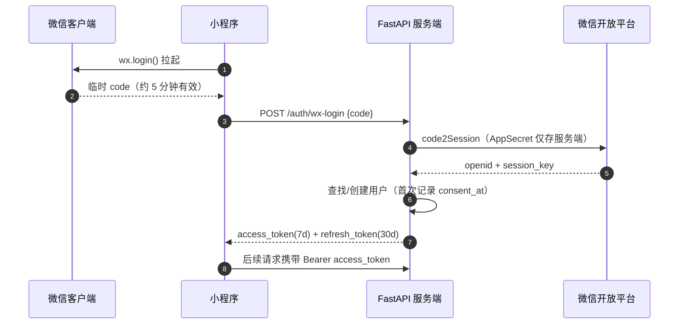

# 心屿 · API 文档

后端基于 Python FastAPI，本文档是小程序端与服务端的接口契约：统一响应结构、23 个接口、流式协议与错误码。服务端实现后，FastAPI 会自动生成交互式调试文档（/docs），两者以本文档为准保持一致。读者：小程序前端、后端、测试。

---

## 1 · 概述与通用约定
````````
| 项 | 约定 |
| --- | --- |
| Base URL | https://api.xinyu.example.cn [待定——域名与证书上线前确定] |
| 路径前缀 | /api/v1 |
| 协议与格式 | HTTPS + JSON，请求/响应均为 UTF-8；Content-Type: application/json |
| 时间格式 | ISO 8601，含时区，如 2026-10-12T23:47:03+08:00 |
| 资源 ID | MongoDB ObjectId 的 24 位十六进制字符串，如 671a3f9e8b2c4d5e6f7081aa |
| 认证方式 | 除登录与求助资源外，所有接口要求请求头 Authorization: Bearer <access_token> |

#### 统一响应结构
HTTP 状态码只表达传输与鉴权层结果（200 / 401 / 429 / 500）；业务结果一律在响应体 `code` 中表达，`code = 0` 表示成功。

```
{
  "code": 0,             // 0 成功；非 0 见"错误码总表"
  "message": "ok",       // 人类可读信息，出错时可直接展示给用户
  "data": { ... }        // 业务数据，出错时可为 null
}
```

#### 分页约定
列表接口统一使用 `page`（从 1 开始）与 `page_size`（默认 20，最大 100），响应在 `data` 中返回 `items`、`total`、`page`、`page_size`。

> **流式接口例外：**发送消息接口（§6）返回 SSE 事件流，不套用统一响应结构；事件格式见 §11 流式响应协议。
> **上传接口例外：**语音转写接口（见本文章节 10）使用 `multipart/form-data` 上传音频（响应仍为统一 JSON 结构）。

## 2 · 认证机制
小程序端通过微信官方登录换取用户身份，服务端以 JWT 维持会话。`openid` 只存在于服务端，任何接口不向客户端下发。access_token 过期后用 refresh_token 静默续期，连续失败才要求用户重新进入。



> 图 1：微信登录时序（令牌有效期 [假设——内测校准]）
401 处理约定：小程序收到 `401 / code=1002` 时先调刷新接口，成功后原请求重放一次；刷新也失败则清空本地令牌，回登录流程（微信登录对用户无感知，实际表现为一次页面刷新）。

## 3 · 接口总表

| # | 方法 | 路径 | 说明 | 认证 |
| --- | --- | --- | --- | --- |
| 1 | POST | /api/v1/auth/wx-login | 微信 code 换 JWT 令牌 | 否 |
| 2 | POST | /api/v1/auth/refresh | 刷新 access_token | 否（需 refresh_token） |
| 3 | GET | /api/v1/users/me | 当前用户信息 | 是 |
| 4 | DELETE | /api/v1/users/me/data | 删除全部数据（软删 30 天） | 是 |
| 5 | GET | /api/v1/users/me/caring | 主动关怀状态（开启 / 订阅授权） | 是 |
| 6 | PUT | /api/v1/users/me/caring | 开启/关闭主动关怀 | 是 |
| 7 | POST | /api/v1/users/me/caring/subscribe | 回填订阅授权结果 | 是 |
| 8 | GET | /api/v1/sessions | 会话列表（分页） | 是 |
| 9 | POST | /api/v1/sessions | 创建会话 | 是 |
| 10 | GET | /api/v1/sessions/{session_id} | 会话详情（含消息） | 是 |
| 11 | PATCH | /api/v1/sessions/{session_id} | 重命名会话 | 是 |
| 12 | DELETE | /api/v1/sessions/{session_id} | 删除会话 | 是 |
| 13 | POST | /api/v1/sessions/{session_id}/messages | 发送消息（流式/非流式） | 是 |
| 14 | POST | /api/v1/messages/{message_id}/feedback | 对回复点赞/点踩 | 是 |
| 15 | GET | /api/v1/emotion/checkins/today | 查询今日打卡 | 是 |
| 16 | POST | /api/v1/emotion/checkins | 每日打卡（覆盖当日） | 是 |
| 17 | GET | /api/v1/emotion/records | 情绪记录列表（分页/筛选） | 是 |
| 18 | GET | /api/v1/emotion/trends | 情绪趋势聚合 | 是 |
| 19 | GET | /api/v1/emotion/weekly-insight | 本周情绪小结（周报洞察） | 是 |
| 20 | GET | /api/v1/practices | 练习卡片目录（V4） | 是 |
| 21 | POST | /api/v1/practices/{practice_id}/complete | 记录练习完成（V4） | 是 |
| 22 | POST | /api/v1/speech/transcribe | 语音转写为文字（V5，不落原始音频） | 是 |
| 23 | GET | /api/v1/crisis/resources | 心理求助资源（公开） | 否 |

## 4 · 认证与用户接口

### POST /api/v1/auth/wx-login
用 `wx.login()` 获取的临时 code 换取 JWT。code 仅可使用一次；换取成功后服务端即刻失效该 code 的重放可能（依赖微信侧约束）。首次登录自动创建用户，并在响应中标记 `is_new`，小程序据此弹出隐私同意弹窗。

#### 请求参数（Body）
``
| 字段 | 类型 | 必填 | 说明 |
| --- | --- | --- | --- |
| code | string | 必填 | wx.login() 返回的临时登录凭证，5–64 字符 |
| nickname | string | 可选 | 用户授权昵称，≤ 30 字；拒绝授权时不上送 |
| avatar_url | string | 可选 | 用户授权头像 URL，≤ 500 字符 |

请求示例

```
curl -X POST https://api.xinyu.example.cn/api/v1/auth/wx-login \
  -H "Content-Type: application/json" \
  -d '{"code":"0a3Xk9000lQeR1xYz200qW4pC7"}'
```

成功响应 200 · code=0

```
{
  "code": 0, "message": "ok",
  "data": {
    "access_token": "eyJhbGciOiJIUzI1NiIs...",
    "refresh_token": "eyJhbGciOiJIUzI1NiIs...",
    "expires_in": 604800,          // access_token 秒数
    "is_new": false,
    "consented": true              // 隐私单独同意状态；false 时小程序必须先弹窗
  }
}
```

``
| 错误 | 场景 | 处理建议 |
| --- | --- | --- |
| 401 · code=1001 | code 无效或已过期 | 重新调 wx.login() 再试一次；连续失败提示稍后再试 |
| 429 · code=9001 | 触发登录接口限流 | 10 次/分钟/IP，指数退避 |

### POST /api/v1/auth/refresh
access_token 过期后的静默续期。refresh_token 单次使用（旋转机制：每次刷新同时下发新的一对令牌，旧 refresh_token 立即作废）。

| 字段 | 类型 | 必填 | 说明 |
| --- | --- | --- | --- |
| refresh_token | string | 必填 | 登录/上次刷新时下发的刷新令牌 |

成功响应 200 · code=0

```
{ "code": 0, "message": "ok",
  "data": { "access_token": "...", "refresh_token": "...", "expires_in": 604800 } }
```

错误：`401 · code=1003` refresh_token 过期或已用 → 清空本地令牌，回到微信登录。

### GET /api/v1/users/me
返回当前用户信息。昵称头像为空时小程序显示默认样式。

```
{ "code": 0, "message": "ok",
  "data": {
    "user_id": "671a3f9e8b2c4d5e6f7081aa",
    "nickname": "晚风",            // 未授权时为 null
    "avatar_url": null,
    "consented": true,
    "checkin_streak": 5,           // 连续打卡天数，用于首页展示
    "memory_greeting": "最近好像有点紧张，先停下来喘口气，我在。",  // 基于最近情绪记录的记忆型问候；无记录为 null
    "created_at": "2026-09-30T10:12:00+08:00"
  } }
```

### DELETE /api/v1/users/me/data
行权接口：删除该用户的全部数据（会话、消息、情绪记录、打卡、风险事件、主动关怀留档），先软删 30 天（用户可登录撤销），期满由后端定时任务自动物理删除（默认每小时扫描一次，配置 `ERASE_RECOVER_DAYS` / `DATA_PURGE_ENABLED` / `DATA_PURGE_INTERVAL_SECONDS`）。[专家判断] 响应立即生效，各查询接口从此刻起不再返回任何数据。
请求参数（Body）

```
{ "confirm_text": "删除" }   // 必须等于"删除"，防止误触；不符合返回 400
```

成功响应 200 · code=0

```
{ "code": 0, "message": "已删除，30 天内登录可撤销",
  "data": { "erase_at": "2026-10-12T23:50:00+08:00", "recover_deadline": "2026-11-11T23:50:00+08:00" } }
```

### GET /api/v1/users/me/caring
V3 主动关怀状态：`enabled` 表示用户是否开启关怀（未关闭），`subscribed` 表示是否仍有订阅授权配额（微信一次性订阅，每次授权可发一条）。

```
{ "code": 0, "message": "ok",
  "data": { "enabled": true, "subscribed": false } }
```

### PUT /api/v1/users/me/caring
开关主动关怀——关闭后后端不再对该用户发起任何订阅消息（可随时重新开启）。

```
{ "enabled": false }        // true=开启，false=关闭
```

成功响应 200 · code=0（data 同 GET）

### POST /api/v1/users/me/caring/subscribe
回填小程序 `wx.requestSubscribeMessage` 的订阅授权结果：`granted=true` 时发送配额 +1（一次性订阅，每次授权可发一条），`false` 不增加。

```
{ "granted": true }
```

成功响应 200 · code=0（data 同 GET）
[专家判断] 主动关怀由后端定时任务触发（默认每日 `CARING_HOUR` 时刻扫描），仅对「未关闭关怀 + 仍有订阅配额 + 命中触发条件（连续 N 天低落 / 打卡中断）」的用户发送，且每周频控（`CARING_MAX_PER_WEEK`，默认 2 条）；未配置订阅模板 ID（`WX_SUBSCRIBE_TEMPLATE_ID`）时安全跳过，不影响主链路。

## 5 · 会话接口

### GET /api/v1/sessions
分页返回当前用户的会话，按最近活跃倒序。

| Query 参数 | 类型 | 必填 | 说明 |
| --- | --- | --- | --- |
| page | int | 可选 | 默认 1 |
| page_size | int | 可选 | 默认 20，最大 100 |

```
{ "code": 0, "message": "ok",
  "data": { "total": 12, "page": 1, "page_size": 20, "items": [
    { "session_id": "671b21c4...", "title": "深夜的考试焦虑", "rounds": 4,
      "status": "active", "last_msg_at": "2026-10-12T23:47:03+08:00" },
    { "session_id": "671905a1...", "title": "面试复盘", "rounds": 12,
      "status": "active", "last_msg_at": "2026-10-11T21:08:41+08:00" }
  ] } }
```

### POST /api/v1/sessions
创建会话。并发活跃会话上限 5 个，超出返回 `code=2003`，提示归档旧会话。
请求与响应

```
# 请求（title 可省略，缺省取首条消息前 12 字）
{ "title": "深夜的考试焦虑" }

# 响应 201 · code=0
{ "code": 0, "message": "ok",
  "data": { "session_id": "671b21c48d1f2a3b4c5d6e7f", "title": "深夜的考试焦虑",
            "rounds": 0, "status": "active", "created_at": "2026-10-12T23:40:00+08:00" } }
```

### GET /api/v1/sessions/{session_id}
会话详情 + 消息记录（进入历史会话时一次拉取，按时间正序；超过 200 条仅返回最近 200 条并提示）。
``
| 路径参数 | 类型 | 说明 |
| --- | --- | --- |
| session_id | string | 24 位 ObjectId；非本人会话返回 404 · code=2005（不暴露存在性） |

```
{ "code": 0, "message": "ok",
  "data": { "session_id": "671b21c4...", "title": "深夜的考试焦虑", "rounds": 4,
    "messages": [
      { "message_id": "671b22d1...", "role": "user", "content": "……", "created_at": "..." },
      { "message_id": "671b22d2...", "role": "assistant", "content": "……",
        "emotion": { "type": "anxious", "intensity": 7 }, "feedback": null, "created_at": "..." }
    ] } }
```

### PATCH /api/v1/sessions/{session_id}
重命名会话。title：1–20 字，必填。响应 `data` 为更新后的会话对象。

### DELETE /api/v1/sessions/{session_id}
删除单个会话及其全部消息与关联情绪记录。响应 `data: null`，`message: "已删除"`。

## 6 · 消息与反馈接口

### POST /api/v1/sessions/{session_id}/messages
核心接口。接收一条用户消息，返回 AI 回复。用户消息入库前经微信内容安全（msgSecCheck）检测，命中违规返回 `code=2006` 且不落库（mock 登录时自动跳过）。两种模式：
- **流式（默认）**：`Accept: text/event-stream`，响应为 SSE 事件流，见 §11 流式响应协议；
- **非流式**：普通 JSON 响应，弱网/降级时使用，回复一次性返回。

| 字段 | 类型 | 必填 | 说明 |
| --- | --- | --- | --- |
| content | string | 必填 | 消息内容，1–2000 字，纯文本 |
| stream | bool | 可选 | 默认 true；false 时走非流式响应 |

> **危机拦截优先：**消息命中一级危机词库时，无论何种模式，本接口不再请求大模型生成闲聊内容，而是返回固定危机话术 + `crisis` 事件/字段。前端必须按事件渲染求助卡片，这是验收红线。
非流式成功响应 200 · code=0

```
{ "code": 0, "message": "ok",
  "data": {
    "message_id": "671b22d29a3b4c5d6e7f8a9b",
    "assistant_reply": "凌晨还在坚持，本身就很不容易了……",
    "emotion": { "type": "anxious", "intensity": 7, "evidence": "越学越慌" },
    "risk_level": "none",
    "crisis": null,                // 命中时为 { "level": "high", "resources": [...] }
    "created_at": "2026-10-12T23:47:05+08:00"
  } }
```

``
| 错误 | 场景 |
| --- | --- |
| 404 · 2001 | 会话不存在 |
| 403 · 2005 | 会话不属于当前用户 |
| 422 · 2004 | 消息为空或超过 2000 字 |
| 429 · 2002 | 会话已达 50 轮上限 / 用户消息触发小时限流（9001） |
| 200 · 3001 | 大模型超时/异常，已降级返回预设共情话术（degraded: true） |

### POST /api/v1/messages/{message_id}/feedback
对 assistant 回复点赞/点踩。点踩必须带原因，进入 bad-case 归档，驱动提示词与词库迭代。
````````
| 字段 | 类型 | 必填 | 说明 |
| --- | --- | --- | --- |
| rating | string | 必填 | like | dislike |
| reason | string | 点踩必填 | 枚举：no_help（没帮助）/ not_understood（不理解我）/ preachy（说教感）/ other |

```
# 请求
{ "rating": "dislike", "reason": "preachy" }

# 响应
{ "code": 0, "message": "已记录，谢谢你的反馈，我会改进", "data": null }
```

## 7 · 情绪数据接口

### GET /api/v1/emotion/checkins/today
查询今日打卡，无记录时 `data: null`（首页据此渲染打卡区或已打卡卡片）。

### POST /api/v1/emotion/checkins
每日打卡。同一天重复提交视为修改，返回 `updated: true`。日期以服务器时区（Asia/Shanghai）为准。

| 字段 | 类型 | 必填 | 说明 |
| --- | --- | --- | --- |
| mood | string | 必填 | calm | ok | low | anxious | irritable |
| note | string | 可选 | 备注，≤ 200 字 |

```
# 请求
{ "mood": "anxious", "note": "明天出分，有点坐不住" }

# 响应
{ "code": 0, "message": "ok",
  "data": { "checkin_id": "671b3a01...", "date": "2026-10-12", "mood": "anxious",
            "intensity": 7, "note": "明天出分，有点坐不住", "updated": false,
            "streak": 5 } }
```

intensity 由 mood 按默认映射生成（calm=2 / ok=4 / low=6 / anxious=7 / irritable=6），不支持用户直传，保证与对话情绪记录可比较。[专家判断]

### GET /api/v1/emotion/records
情绪记录时间线，合并对话来源与打卡来源，按时间倒序分页。
``
| Query 参数 | 类型 | 必填 | 说明 |
| --- | --- | --- | --- |
| start / end | date | 可选 | 时间范围，如 2026-10-01；默认近 30 天 |
| emotion | string | 可选 | 按类别筛选（六类之一） |
| page / page_size | int | 可选 | 默认 1 / 20 |

```
{ "code": 0, "message": "ok",
  "data": { "total": 42, "page": 1, "page_size": 20, "items": [
    { "record_id": "671b22d3...", "source": "message", "ref_id": "671b22d1...",
      "emotion": "anxious", "intensity": 7, "evidence": "越学越慌，睡不着",
      "risk_level": "none", "session_title": "深夜的考试焦虑",
      "created_at": "2026-10-12T23:47:06+08:00" },
    { "record_id": "671b3a01...", "source": "checkin", "ref_id": "671b3a01...",
      "emotion": "depressed", "mood": "low", "intensity": 6, "evidence": null, "note": "上午出分了，比预期低一些",
      "risk_level": "none", "session_title": null,
      "created_at": "2026-10-12T12:30:00+08:00" }
  ] } }
```

打卡 mood 在合并时归一化为六类枚举（low→depressed、irritable→angry），与对话来源情绪口径一致；checkin 条目附原始 `mood`（当日备注编辑回传用）与 `note`（打卡备注，无则为 null）；message 条目附 `evidence` 与 `session_id`（定位来源对话跳转用）。

### GET /api/v1/emotion/trends
趋势聚合，服务端完成计算，小程序只渲染。

| Query 参数 | 类型 | 必填 | 说明 |
| --- | --- | --- | --- |
| granularity | string | 可选 | day（默认）| week | month |
| days | int | 可选 | 统计窗口，7 或 30，默认 7 |

```
{ "code": 0, "message": "ok",
  "data": {
    "window": 7, "granularity": "day",
    "avg_intensity": 6.1, "prev_avg_intensity": 6.9,   // 与上一窗口对比
    "points": [
      { "date": "2026-10-12", "avg_intensity": 6.4, "dominant": "anxious", "count": 3 },
      { "date": "2026-10-13", "avg_intensity": null, "dominant": null, "count": 0 }  // 无记录置 null，不补 0
    ],
    "dominant_emotion": { "type": "anxious", "ratio": 0.62 }
  } }
```

### GET /api/v1/emotion/weekly-insight
V2 周报洞察：基于与 `trends` 同源的聚合数据，服务端生成**描述性**「本周情绪小结」，供情绪日志页展示。文案只陈述现象（如「焦虑多出现在晚上」），**不做归因断言**（不出现「因为 / 导致 / 由于」类因果句式）。

| Query 参数 | 类型 | 必填 | 说明 |
| --- | --- | --- | --- |
| days | int | 可选 | 统计窗口，7 或 30，默认 7 |

```
{ "code": 0, "message": "ok",
  "data": {
    "window_days": 7, "start_date": "2026-10-13", "end_date": "2026-10-19",
    "has_data": true, "record_count": 9, "record_days": 4, "checkin_days": 3,
    "avg_intensity": 5.4, "prev_avg_intensity": 6.1, "intensity_trend": "down",
    "dominant_emotion": { "type": "anxious", "ratio": 0.44 },
    "peak_period": "evening", "peak_period_label": "晚上",
    "period_counts": { "morning": 1, "afternoon": 2, "evening": 5, "night": 1 },
    "highlights": [
      "近 7 天你记录了 4 天、共 9 条情绪记录。",
      "本周以「焦虑」为主（占 44%）。",
      "「焦虑」多出现在晚上。",
      "整体情绪强度比上周略有下降（6.1 → 5.4）。",
      "本周打卡 3 天。"
    ]
  } }
```

- `has_data: false` 时 `dominant_emotion` / `peak_period` 为 null、`period_counts` 为空对象，`highlights` 仅含一句引导；客户端据此决定是否展示小结卡。
- 时段按业务时区（Asia/Shanghai）划分：早上 5–11 / 下午 12–17 / 晚上 18–22 / 深夜 23–4；`intensity_trend` 为 `up | down | flat | none`（`none` 表示无上周可比数据）；`highlights` 为服务端拼好的中文短句列表，小程序只渲染。

## 8 · 危机资源接口

### GET /api/v1/crisis/resources
唯一不需要登录的接口——求助资源是公共安全信息，未登录用户（含未同意隐私弹窗者）也能访问。内容运营侧可更新，小程序内置兜底静态副本。

```
{ "code": 0, "message": "ok",
  "data": { "version": 3, "updated_at": "2026-09-20T10:00:00+08:00",
    "resources": [
      { "id": "hotline-12356", "name": "全国心理援助热线", "phone": "12356",
        "hours": "24 小时", "note": "免费 · 匿名", "priority": 1 },
      { "id": "hotline-hope24", "name": "希望24热线", "phone": "400-161-9995",
        "hours": "24 小时", "note": "学生倾诉专线", "priority": 2 },
      { "id": "hotline-12355", "name": "12355 青少年服务热线", "phone": "12355",
        "hours": "工作日 8:00–20:00", "note": "共青团渠道", "priority": 3 },
      { "id": "campus-center", "name": "校心理咨询中心", "phone": "0XX-XXXXXXXX",
        "hours": "工作日 9:00–17:00", "note": "线下预约", "priority": 4 }
    ] } }
```

校心理中心电话 [待填]；各地 12356 开通情况以当地为准 [需核实]。小程序按 priority 升序展示。

## 9 · 练习卡片接口（V4）
把提示词里已有的「身体优先 / 呼吸练习」话术产品化——呼吸引导、正念呼吸空间、行为激活小任务，做成可交互卡片。**内容仅供放松与觉察，不替代专业帮助；文案 [待专业审校]（联动 M2 心理中心老师复核）。**

### GET /api/v1/practices
返回内置卡片目录（含今日已完成标记）。

```
{ "code": 0, "message": "ok",
  "data": {
    "practices": [
      { "id": "breath_478", "category": "breathing", "title": "4-7-8 呼吸",
        "subtitle": "睡前放松，帮身体慢慢慢下来", "duration_seconds": 120,
        "pattern": { "inhale": 4, "hold": 7, "exhale": 8 },
        "steps": ["找个舒服的姿势坐好或躺下", "..."], "reviewed": false, "completed_today": false },
      { "id": "activate_micro", "category": "activation", "title": "微小行动",
        "subtitle": "没力气的时候，从一件小事开始", "duration_seconds": 60,
        "tasks": ["起身接一杯水", "..."], "reviewed": false, "completed_today": false }
    ],
    "completed_today": ["breath_478"]
  } }
```

`category` 三档：`breathing`（配 `pattern` 供呼吸动画）/ `mindfulness`（配 `steps` 分步引导）/ `activation`（配 `tasks` 行动清单）。`reviewed=false` 表示尚未经专业审校。

### POST /api/v1/practices/{practice_id}/complete
记录一次练习完成（同日可多次，仅记录次数与时长，不含对话/情绪原文）。

```
{ "duration_seconds": 120 }   // 可选，缺省用卡片建议时长
```

成功响应 200 · code=0

```
{ "code": 0, "message": "ok",
  "data": { "practice_id": "breath_478", "completed": true, "times_today": 1 } }
```

未知 `practice_id` 返回 2001（HTTP 404）。

## 10 · 语音转写接口（V5）

把「语音倾诉」入口做成：小程序录音 → 服务端转写为文字 → 回到对话输入框，**由用户确认（可编辑）后再发送**，避免误转写直接进入对话。

**合规基线（硬约束）**：音频仅用于本次转写，**转写后即弃、不落原始音频**——不写数据库、不落磁盘，服务日志只记体积与结果状态，不含音频与转写原文。转写结果作为普通消息进入对话主链路后，才由发送消息接口（§6）统一执行内容安全与危机拦截（语音不另开旁路）。

### POST /api/v1/speech/transcribe

`multipart/form-data` 上传录音文件，字段名 `file`。支持 mp3 / aac / m4a / wav / webm / ogg 等常见容器。

```
POST /api/v1/speech/transcribe
Content-Type: multipart/form-data; boundary=...

--boundary
Content-Disposition: form-data; name="file"; filename="voice.mp3"
Content-Type: audio/mpeg

<音频二进制>
--boundary--
```

成功响应 200 · code=0

```
{ "code": 0, "message": "ok", "data": { "text": "我这两天总是睡不好，心里挺烦的" } }
```

| 情形 | HTTP · code | 说明 |
| --- | --- | --- |
| 未登录 | 401 · 1002/1003 | 先走登录/刷新流程 |
| 音频为空 / 超过体积上限（默认约 2MB，前端同步限录音 60s） | 400 · 5001 | 换段短一点重录 |
| 音频格式不支持 / 转写服务未配置 / 转写失败 / 未识别出文字 | 400 · 5001 | 按 `message` 提示，**前端降级回键盘输入**，不阻断对话 |

> fail-safe：语音转写服务未配置或异常时返回明确的 5001，**前端一律可继续用键盘输入**，不影响对话主链路（与 V3 未配置订阅模板 ID 的取舍一致）。
> 提供方：`ASR_PROVIDER=mock` 为本地联调占位（返回固定文本，生产启动校验禁止）；生产为 `http`，指向配置的通用 ASR 网关（`ASR_ENDPOINT_URL`，POST 原始音频字节并返回 `{"text": "..."}`）。

## 11 · 流式响应协议（SSE over chunked）
发送消息接口（`stream=true`）返回 `text/event-stream`。小程序 `wx.request` 不支持标准 SSE，但开启 `enableChunked: true` 后可通过 `onChunkReceived` 逐块接收（基础库 2.20.1 起，提审前实测确认最低版本 [需核实]）。服务端按 SSE 帧格式输出，每块为一个或多个完整事件。

#### 事件序列
****
| event | 时机 | data 字段 | 前端动作 |
| --- | --- | --- | --- |
| meta | 流开始 | user_message_id | 落用户气泡 |
| delta | 0..N 次 | content（增量文本） | 追加渲染 AI 气泡 |
| crisis | 命中危机词（先于 delta） | level, resources[] | 立即弹出求助卡片 |
| emotion | done 之前（分析完成时） | type, intensity, evidence | 渲染本轮情绪角标 |
| done | 流结束 | message_id, degraded | 解锁输入框；degraded=true 时提示重试 |
| error | 任意时刻异常 | code, message | 终止渲染，展示重试按钮 |

正常顺序：meta → (crisis) → delta×N → emotion → done。crisis 事件保证先于任何 delta 出现；emotion 事件在分析成功时下发，分析超时/失败时可能缺失（失败不阻塞回复，也不写错误数据）。
原始帧示例

```
event: meta
data: {"user_message_id":"671b22d19a3b4c5d6e7f8a9c"}

event: delta
data: {"content":"凌晨还在坚持，"}

event: delta
data: {"content":"本身就很不容易了。"}

event: emotion
data: {"type":"anxious","intensity":7,"evidence":"越学越慌，睡不着"}

event: done
data: {"message_id":"671b22d29a3b4c5d6e7f8a9b","degraded":false}
```

> **断帧处理：**块边界可能切断一个事件（SSE 事件以空行分隔）。前端必须维护接收缓冲区，按 `\n\n` 切分完整事件后再解析；10 秒无新块视为中断，保留已渲染内容并展示重试。

## 12 · 错误码总表

| code | HTTP | 含义 | 用户可见处理 |
| --- | --- | --- | --- |
| 0 | 200 | 成功 | — |
| 1001 | 401 | 微信 code 无效/过期 | 重新 wx.login，一次自动重试 |
| 1002 | 401 | access_token 缺失/过期 | 静默刷新后重放一次 |
| 1003 | 401 | refresh_token 过期/已用 | 清空令牌，回登录流程 |
| 2001 | 404 | 资源不存在 | 提示并退回列表页 |
| 2002 | 429 | 会话轮次达 50 轮上限 | 提示开启新会话 |
| 2003 | 429 | 并发活跃会话超过 5 个 | 提示归档旧会话 |
| 2004 | 422 | 内容为空或超 2000 字 | 输入框旁行内提示 |
| 2005 | 404 | 资源不属于当前用户（不暴露存在性） | 同 2001 处理 |
| 2006 | 422 | 内容未通过微信安全检测（msgSecCheck） | 调整措辞后重发 |
| 3001 | 200 | 大模型超时，已降级返回预设话术 | degraded=true，展示重试 |
| 3002 | 502 | 大模型服务异常（重试后仍失败） | 稍后再试 |
| 4001 | — | 危机拦截标记（信息性，非错误，随 crisis 事件下发） | 渲染求助卡片 |
| 5001 | 400 | 业务校验失败（如 confirm_text 不符） | 按 message 提示 |
| 9001 | 429 | 触发限流 | 指数退避，提示稍后再试 |
| 9999 | 500 | 服务端未知错误 | 提示稍后再试，服务端告警 |

## 13 · 数据模型参考
与 MongoDB 集合一一对应，字段定义供前后端对齐。时间均为 ISO 8601 字符串；`emotion.type` 六类：`calm / ok / anxious / depressed / angry / other`。
********************
| 模型 | 字段 |
| --- | --- |
| Session | session_id · user_id · title(≤20) · rounds(≤50) · status(active|archived) · created_at · last_msg_at |
| Message | message_id · session_id · role(user|assistant) · content(≤2000) · emotion{type,intensity,evidence} · risk_level · feedback{rating,reason} · degraded(bool) · created_at |
| EmotionRecord | record_id · user_id · source(message|checkin) · ref_id · emotion · intensity(1–10) · risk_level · created_at |
| Checkin | checkin_id · user_id · mood · intensity · note(≤200) · date(yyyymmdd，唯一索引 user_id+date) · created_at |
| RiskEvent | event_id · user_id · session_id · level(low|mid|high) · trigger(lexicon|model) · created_at（仅服务端写入与审计读取，无对外查询接口） |
| PracticeLog | practice_id · user_id · category(breathing|mindfulness|activation) · duration_seconds · date(yyyymmdd) · created_at（V4；仅服务端写入与统计） |

> 语音转写（V5）**不落库**：`POST /api/v1/speech/transcribe` 的音频与转写结果均不持久化（合规基线：转写后即弃、不落原始音频）。

## 14 · 限流与安全

| 范围 | 限制 | 说明 |
| --- | --- | --- |
| 登录/刷新 | 10 次/分钟/IP | 防 code 重放与爆破 |
| 发送消息 | 30 条/小时/用户 | 防成本失控 [假设——内测校准] |
| 其余读接口 | 60 次/分钟/用户 | Nginx 应用层双层执行 |
| 数据导出 | 1 次/天/用户（二期规划，当前未实现限流） | `GET /api/v1/users/me/data/export` 同步返回 JSON（非异步任务） |

#### 安全要点
- JWT HS256 签名，密钥仅存服务端环境变量；openid 不下发，任何接口不回传。
- 所有查询强制 `user_id` 过滤；跨用户访问统一表现为 404，不暴露资源存在性。
- 对话内容应用层 AES-256-GCM 加密后入库，密钥与数据库分离管理；服务日志仅含接口、耗时、错误码与脱敏 ID。
- 危机卡片资源接口无鉴权是有意设计（公共安全信息），其余无鉴权路径一律不存在。
- 语音转写（V5）：音频不落库、不落盘、日志不含音频与转写原文；单段录音限 60s / 约 2MB。
- 全链路 HTTPS；小程序侧配置 request 合法域名白名单。

## 15 · 小程序端接入示例
登录与请求封装（utils/api.js）

```
// 统一请求：自动携带令牌、处理 401 静默续期（简化示例）
const BASE = 'https://api.xinyu.example.cn';

function request(path, method, data) {
  return new Promise((resolve, reject) => {
    wx.request({
      url: BASE + path, method, data,
      header: {
        'Content-Type': 'application/json',
        'Authorization': 'Bearer ' + wx.getStorageSync('access_token')
      },
      success(res) {
        if (res.statusCode === 401) { refreshTokenAndRetry(path, method, data); return; }
        res.data.code === 0 ? resolve(res.data.data) : reject(res.data);
      },
      fail: reject
    });
  });
}
```

流式发送消息（对话页核心逻辑，含断帧缓冲）

```
function sendMessage(sessionId, content) {
  let buffer = '';              // SSE 断帧缓冲区（关键）
  wx.request({
    url: `${BASE}/api/v1/sessions/${sessionId}/messages`,
    method: 'POST',
    enableChunked: true,         // 基础库 >= 2.20.1，提审前实测
    header: { 'Content-Type': 'application/json',
               'Authorization': 'Bearer ' + wx.getStorageSync('access_token') },
    data: { content, stream: true },
    success() {}, fail() { showError(); },
    onChunkReceived(res) {
      buffer += ab2str(res.data);           // ArrayBuffer 转字符串
      const frames = buffer.split('\n\n');  // 完整事件以空行分隔
      buffer = frames.pop();                // 最后一段可能不完整，留在缓冲区
      frames.forEach(handleFrame);          // 解析 event:/data: 两条
    }
  });
}

// handleFrame 中：crisis 事件 → 立即渲染求助卡片；
// delta → 追加气泡；done → 解锁输入框；10s 无新块 → 中断重试
```

ArrayBuffer 转字符串按 UTF-8 处理；低版本基础库无 TextDecoder 时用 `decodeURIComponent(escape())` 方案兜底 [需实测]。完整断帧与超时逻辑见开发文档功能需求 F2 边界与异常。
