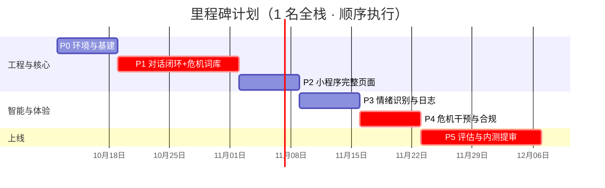
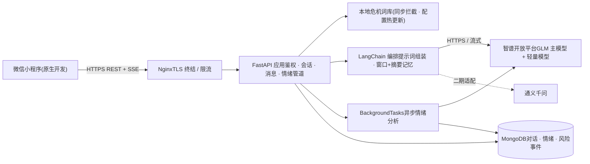
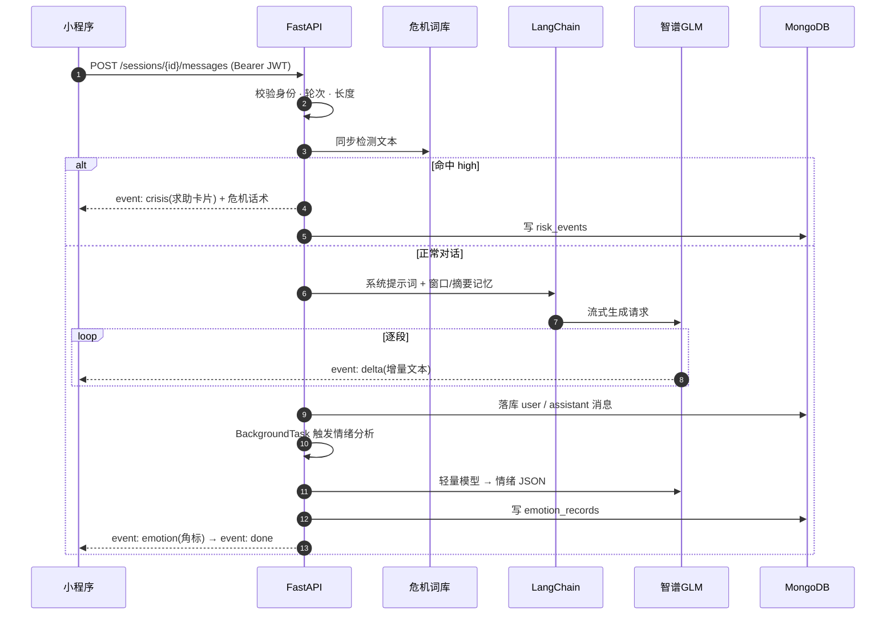

# 心屿 · 校园心理咨询智能陪伴 Agent — 开发文档

开发文档：产品定位、8 周 5 阶段开发流程、功能需求、AI 能力、技术方案与合规风险。交互原型见原 HTML（campus-agent-dev-doc.html）。

---

## 概览：做什么，不做什么
心屿是一款面向高校学生的微信小程序。学生随时与 AI 陪伴者「小屿」多轮对话倾诉烦恼，系统在对话中识别焦虑、抑郁等情绪并给出疏导建议，长期沉淀为情绪日志。它不是诊疗工具，定位是"倾诉出口 + 自我觉察 + 专业资源的桥"。

### 产品定位
高校心理咨询中心的预约量与学生实际需求之间存在缺口，而不少学生因为"觉得不算大事""怕被议论"等原因，宁可熬夜自己消化，也不走进咨询室。[专家判断] 心屿要补的是这段"还没准备好求助"的过程：一个匿名、随时在线、不评判的倾听者，并在识别到持续低落或危机信号时，主动递上专业求助的入口。

> **产品边界（全团队必须达成一致）：**不输出诊断结论，不推荐药物，不宣称治疗作用；情绪识别结果仅用于陪伴策略与自我觉察展示，不作为任何"心理测评报告"。检测到高风险信号时，产品的责任是清晰、温和、反复地转介真人资源，而不是自己处理危机。

### 目标与成功指标

| 指标 | 定义 | 目标值 | 说明 |
| --- | --- | --- | --- |
| 流式首字延迟 | 发送消息到收到第一个回复字符的 P95 时间 | ≤ 3s | 超过则必须给出"小屿正在听"的等待反馈 |
| 情绪识别一致率 | 离线评估集上，模型情绪分类与人工标注一致的比例 | ≥ 80% | M3 首测已留档（`docs/emotion-eval-m3.md`：45 条 86.7%）；P5 正式评估已留档（`docs/emotion-eval-p5.md`：59 条 86.4%、强度 MAE 1.37、对抗 11 条，go/no-go 达标） |
| 危机信号召回 | 测试用例中自伤/自杀类信号的触发比例 | ≥ 95%，一票否决 | 宁可误报，不可漏报；上线前必须全量通过 |
| 疏导有效反馈率 | 回复获得点赞 /（点赞+点踩），按会话末统计 | ≥ 70% [假设——待内测校准] | 点踩必须带原因标签，进入 bad-case 归档 |
| 情绪日志留存 | 新用户次周仍产生至少 1 条情绪记录的比例 | ≥ 25% [假设——待内测校准] | 长期跟踪价值成立的前提 |

### 目标用户与核心场景
深夜倾诉者 · 小林核心 · 高频场景
- 大二，考前焦虑，习惯凌晨自我消化
- 需求：即刻被听见 + 平复到能睡着
- 频率：压力期每周 3–4 次，深夜为主 [假设]
观望者 · 阿哲高价值 · 转介目标
- 持续低落两周以上，对真人咨询有病耻感
- 需求：先匿名试探"我的情况严重吗"
- 产品责任：识别持续抑郁倾向，引导线下求助
咨询间期使用者 · 小敏辅助 · P2 优先级
- 已在心理中心咨询，两次咨询之间需要日常支撑
- 需求：情绪记录 + 轻量疏导
- 边界：不替代、不干预其咨询方案 [专家判断]

### 核心场景优先级

| # | 场景 | 用户来意 → 产品响应 | 优先级 |
| --- | --- | --- | --- |
| S1 | 深夜焦虑倾诉 | 写一段烦躁 → 秒级共情回应，先接住情绪再给一个可做的小动作（如呼吸练习） | P0 |
| S2 | 持续低落的多轮对话 | 连续多轮暴露抑郁倾向 → 回应转向行为激活与求助建议，情绪日志连续标红 | P0 |
| S3 | 危机信号出现 | 表达自伤/轻生念头 → 立即展示求助卡片，本轮回复以关心与转介为主，禁说教 | P0 红线 |
| S4 | 日常自我觉察 | 每天打开打卡 → 看趋势、回看记录，发现"周二总是最丧" | P1 |

MVP 范围 = S1、S2、S3 + S4 的打卡与趋势基础版。群组互助、冥想内容库、量表自评、教师端看板均列为二期候选，本期不做。

## 开发流程：八个星期，五个阶段
总体策略：先用两星期把"登录 → 对话 → 落库"这条最小链路在真机上跑通，再叠加情绪智能，最后做合规加固与评估上线。危机词库的最小版本在阶段 1 就要上线——安全兜底不能等模型能力就绪。节奏按 1 名全栈开发估算 [假设]，两人协作可把关键路径压缩到约 6 周。
P0环境与基建第 1 周
- 注册微信小程序，取得 AppID；确定主体类型与类目（关系到能否过审，见"合规与风险"）
- 后端脚手架：FastAPI + `uvicorn`，统一响应结构、异常处理器、`/health` 接口
- MongoDB 本地实例（Docker）+ motor 异步驱动，建库建集合（见"技术方案"数据模型）
- 申请智谱开放平台 API Key，跑通一次最简调用；确定主模型与轻量模型档位
- 仓库结构：`backend/`（FastAPI）与 `miniprogram/`（微信开发者工具工程）分目录管理

> **验收：**小程序显示占位首页；`GET /health` 返回 200；后端能打印一次大模型返回。
P1对话闭环（MVP 核心）+ 最小危机词库第 2–3 周
- 微信登录全链路：`wx.login` → code 换 openid → 签发 JWT（详见 API 文档）
- 会话与消息接口（非流式版先跑通），消息与轮次规则落库
- LangChain 接入：系统提示词 V1 + 会话历史记忆（窗口 20 轮），输出能稳定共情
- **本地危机词库同步拦截器**：两级词表（见"AI 能力"），命中高危词立即返回求助卡片事件——此功能不依赖任何模型，本阶段必须可用
- 流式升级：FastAPI SSE + 小程序 `wx.request` 分块接收（`enableChunked`），非流式作为降级路径保留

> **验收：**真机连续对话 20 轮上下文不断；流式首字 ≤ 3s；输入"不想活了"等测试句，求助卡片 100% 触发。
P2小程序完整页面第 4 周
- 四个 Tab 页按本档原型实现：首页（打卡 + 入口）、对话、情绪日志（占位）、我的
- 历史会话列表、继续会话、删除会话；输入框长度限制与键盘适配
- 等待、网络错误、空列表三种状态；登录态过期静默续期

> **验收：**完成一次"打卡 → 倾诉 → 看历史 → 删除会话"的全流程真机走查，无阻塞缺陷。
P3情绪识别与日志第 5 周
- 回复送达后异步情绪分析（BackgroundTasks + 轻量模型 JSON 输出），写入 emotion_records
- 日志页时间线（对话来源 + 打卡来源合并）与 7 天趋势图
- 每日打卡接口与"连续记录天数"统计；首页记忆型问候（读取最近一次情绪记录生成）

> **验收：**每条用户消息在 5s 内产出情绪记录；日志页数据与对话内容抽查一致；离线评估集上情绪分类一致率首次测量留档。
P4危机干预与合规加固第 6 周
- 危机双保险补全：本地词库 + 模型 `risk_level` 异步判定；分级响应（软提示/卡片/卡片+常驻入口）
- 首次运行隐私弹窗（单独同意）、免责声明页、隐私政策正文
- 用户数据权利：导出（JSON 下载链接）、删除全部数据（软删 30 天后物理删除 [专家判断]）
- 对话内容应用层加密存储、日志脱敏、限流配置

> **验收：**危机测试用例集（自伤/轻生/暴力等 ≥ 20 条）全量触发；权限最小化核查表通过；删除数据后接口不再返回任何痕迹。
P5评估、内测与提审第 7–8 周
- 离线评估集补齐至 ≥ 50 条并完成人工标注；提示词迭代到 V2 并记录版本对比
- 内测：本校 30–50 名学生体验版，收集点赞/点踩与访谈，重点看疏导有效反馈率与危机误报体验
- 压测与成本核对：单用户日成本、峰值并发（班级晚自习后 [假设]）
- 整理类目资质材料、隐私协议终稿、小程序提审；保留降级开关（情绪分析可关、流式可关）

> **验收：**五项 go/no-go（见"AI 能力"评估一节）全部通过后提审；审核意见 48 小时内响应。



> 图 1：八周里程碑甘特图（crit 标记为安全相关关键路径，不可压缩）

### 演示节点与交付物

| 节点 | 时点 | 向谁演示 | 看什么 |
| --- | --- | --- | --- |
| M1 | 第 3 周末 | 产品/导师 | 真机 20 轮连续对话 + 危机测试句触发卡片 |
| M2 | 第 4 周末 | 全团队 | 四页面全流程走查，UI 对照原型验收 |
| M3 | 第 5 周末 | 产品/导师 | 情绪日志可视化 + 首次准确率测量报告 |
| M4 | 第 6 周末 | 法务/学校主管部门 [待确认参与方] | 隐私弹窗、免责声明、数据删除演示 |
| M5 | 第 8 周 | 内测学生 | 体验版二维码 + 反馈收集渠道 |

## 功能需求
左侧原型可点击，点击任意区域会跳转到对应的功能详情。每个功能按"业务逻辑 / 交互逻辑 / 规则约束 / 边界与异常"四层描述，字段与状态规则供开发直接使用。

### 功能总表

| # | 模块 | 功能描述 | 优先级 |
| --- | --- | --- | --- |
| F1 | 首页与情绪打卡 | 每日一次五档情绪打卡（可附 200 字备注），写入当日 checkin；首页聚合问候语、"开始倾诉"入口、每日一句、基于最近情绪记录生成的记忆型提示 | P1 |
| F2 | 对话陪伴 | 多轮流式对话；发送后先经本地危机词库同步检测，再由大模型流式生成共情回复并落库；支持会话列表、继续、重命名、删除；每轮回复可点赞/点踩 | P0 |
| F3 | 情绪识别与疏导 | 每条用户消息回复后异步识别情绪（六类 + 强度 1–10 + 依据摘录），写入情绪记录；疏导策略按情绪类别映射（见 F3 详情），高强度或持续低落时回复内嵌建议求助的话术 | P0 |
| F4 | 危机干预 | 本地词库同步拦截 + 模型异步风险判定双保险；分级响应：low 软提示、mid 求助卡片、high 卡片 + 会话内常驻求助入口；触发均写入 risk_events 供审计 | P0 红线 |
| F5 | 情绪日志 | 时间线合并展示对话情绪与打卡记录；7 天 / 30 天趋势图与均值对比；连续记录天数；支持按情绪类别筛选 | P1 |
| F6 | 账户与数据 | 微信登录（仅取 openid，昵称头像按需授权）；首次运行隐私单独同意弹窗；免责声明常驻"我的"页；支持导出全部数据（JSON）与删除全部数据 | P1 |

F1

#### 首页与情绪打卡
P1**业务逻辑：**用户在五档情绪（平静/还行/低落/焦虑/烦躁）中选择一档，可选填备注，提交后写入当日 checkin（每用户每日仅一条，重复提交覆盖并提示"已更新今天的记录"）。首页问候语按时段变化（上午/下午/深夜三档文案）；记忆型提示读取最近一条情绪记录，套用固定话术模板生成，不额外调用大模型。**交互逻辑：**点击情绪按钮 → 选中态高亮并上浮（见原型）→ 出现"记下原因（可选）"折叠输入 → 提交后按钮区变为今日结果卡片。点击"开始倾诉" → 跳转对话页并新建会话。**规则约束：**备注 ≤ 200 字；checkin 记录含 mood（枚举）、intensity（1–10，默认映射：平静=2/还行=4/低落=6/焦虑=7/烦躁=6 [专家判断]）、note、created_at。**边界与异常：**打卡请求失败时本地暂存、下次启动重试并提示；跨天以服务器时间为准，避免客户端改时间刷连续天数。F2

#### 对话陪伴
P0**业务逻辑：**发送消息 → 后端同步执行：身份校验 → 轮次/长度校验 → 本地危机词库检测（命中高危词则本轮回复走危机话术并推送卡片事件，不再请求大模型闲聊生成 [专家判断]）→ 组装系统提示词与窗口记忆 → 调用大模型流式生成 → 全文落库（user 与 assistant 各一条）→ 异步触发情绪分析（F3）。**交互逻辑：**发送后输入框立即置灰防重发 → 显示"小屿正在输入"动效 → 流式逐段上屏 → 完成后恢复输入。回复气泡下方常驻点赞/点踩小图标（点踩需选原因：没帮助/不理解我/说教感/其他）。会话切换通过"我的-历史会话"或对话页头部进入。**规则约束：**单条消息 ≤ 2000 字；单会话 ≤ 50 轮（超出提示"这个话题聊得很深了，建议开个新会话"并禁发 [假设——上限待内测调整]）；每用户并发会话 ≤ 3 个；会话标题默认取首条消息前 12 字，可手动改名（≤ 20 字）。**边界与异常：**流式中断 10s 无增量 → 前端停止并展示"重试"按钮，保留已收文本；大模型超时/异常 → 退避重试 1 次，仍失败则返回预设共情话术（"我还在，刚才走神了，你愿意再说一遍吗"）并记入降级日志；词库误报（如引用歌词）时用户可点"这不是我的本意"关闭卡片，该反馈进入词库调优清单。F3

#### 情绪识别与疏导
P0**业务逻辑：**回复送达后由后台任务调用轻量模型，输入"本轮用户消息 + 前两轮上下文"，输出结构化 JSON（见"AI 能力"规格），写入 emotion_records；疏导策略由模型输出的 emotion + intensity 驱动，映射关系见下表。情绪记录不阻塞、不主导回复内容，回复话术由主对话链路的系统提示词约束。
| 识别结果 | 疏导策略（写进系统提示词的倾向） | 页面表现 |
| --- | --- | --- |
| 焦虑 · 强度 ≤ 6 | 接纳 + 具体化担忧 + 一个当下可做的 grounding 动作 | 对话页本轮角标"焦虑 5" |
| 焦虑 · 强度 7–10 | 身体优先：呼吸/放松引导，暂缓认知分析 | 角标红色，日志趋势标记 |
| 抑郁 · 强度 ≤ 6 | 低门槛行为激活（如"下楼走五分钟"）+ 避免空洞鼓励 | 角标灰蓝 |
| 抑郁 · 强度 7–10 或连续 3 轮低落 | 共情 + 温和提出"学校心理中心的老师可以陪你聊聊"，每周最多主动建议一次，避免说教 [专家判断] | 角标红色 + 日志页连续记录提醒 |
| 愤怒/其他 | 命名情绪 + 允许表达，不急于纠正 | 角标按类别着色 |

**规则约束：**情绪枚举固定六类：calm/ok/anxious/depressed/angry/other，强度 1–10；情绪记录保留 evidence 字段（≤ 50 字摘录）供用户回看"为什么这么判"；单条消息只产出一条情绪记录，不重复分析。**边界与异常：**分析超时或 JSON 解析失败 → 该轮不写情绪记录（宁可缺失不写错误数据），失败计数入监控；连续失败率 > 5% 触发告警。F4

#### 危机干预
P0 红线
> **本功能是安全底线，验收一票否决。**策略：宁可误报，不可漏报。误报的代价是一次多余但真诚的卡片；漏报的代价可能是不可挽回的。词库误报可通过用户反馈与运营持续收窄。
**双重检测：**① 本地词库同步检测——两级词表，一级（即时危险：自杀/轻生/自残等强信号词，命中即 high）；二级（风险语境：撑不下去/消失/解脱等弱信号词，命中计 2 分，同会话累计 ≥ 4 分升 high）。词库由运营配置表维护，支持热更新，不依赖模型。② 模型异步兜底——情绪分析 JSON 中的 `risk_level` 为 mid/high 时补写 risk_events，若会话内尚未展示过卡片则即时推送。**分级响应：**
- **low：**不弹卡片；回复末尾追加一句温和的关心（由提示词控制）
- **mid：**回复流结束后插入求助卡片（见原型），本轮话术以关心与"值得被专业帮助"为主，禁用任何说教/评判句式
- **high：**卡片即时置顶展示 + 该会话头部常驻"随时可求助"入口，直到会话结束；不限制用户继续对话
**规则约束：**卡片内容（热线列表）由 `GET /crisis/resources` 下发，运营可改，不硬编码进小程序包；同会话内 high 级不重复弹窗（入口已常驻）；全部触发写入 risk_events（级别、命中方式、会话 ID、时间），留存期 ≥ 12 个月用于审计 [专家判断]。**边界与异常：**用户明确否认（"我在引用歌词/开玩笑"）→ 尊重用户，卡片可关闭，但 high 级常驻入口不撤；resources 接口失败 → 使用小程序内置的兜底热线静态副本（发版时同步）。F5

#### 情绪日志
P1**业务逻辑：**合并两个来源：每轮对话的 emotion_records 与每日 checkin，按时间倒序分日展示。趋势图取近 7/30 天的 intensity 日均值，支持按情绪类别筛选时间线。均值计算在服务端聚合接口完成，小程序不做原始数据计算。**交互逻辑：**进入页面先渲染趋势卡（含与上周均值对比），再加载时间线（分页 20 条）；点击时间线条目 → 定位到来源对话（打卡记录展开备注编辑入口仅当日有效）。**规则约束：**时间线每条显示来源、时间、类别角标、强度、一句话摘录；某日无记录则趋势图断点跳过该日，不补 0。**边界与异常：**数据为空 → 引导空状态"和我说说今天，日志会自动长出来"；单月超过 2000 条时时间线仅保留摘要 + "查看更多"分页。F6

#### 账户与数据
P1**业务逻辑：**微信登录仅换取 openid 作为用户主键，昵称头像通过可选授权获取，用户名等身份信息一律不收集（学号、手机号、位置均不在采集范围）。首次启动弹隐私同意（单独同意，未同意不可使用核心功能，但可浏览免责声明与求助热线——热线是公共安全信息 [专家判断]）。**交互逻辑：**"隐私与数据"页提供两个动作：导出（生成 JSON 下载链接，48 小时有效）与删除全部数据（二次确认 + 输入"删除"确认，软删 30 天，期间登录可撤销 [专家判断]）。**规则约束：**免责声明与隐私政策入口在"我的"页常驻且不可隐藏；版本号、意见反馈入口同页展示。**边界与异常：**昵称头像授权被拒 → 显示默认昵称"同学"+ 默认头像，不阻塞使用；登录态过期 → 静默用 refresh token 续期，连续失败才引导重新登录。

## AI 能力规格
两条模型链路：主对话链路负责"怎么回"，情绪分析链路负责"怎么看"。两条链路职责分离，情绪分析永远不阻塞回复。模型档位以智谱在售型号为准接入时确认 [待确认]，架构上预留通义千问适配位。

### 任务定义与输入输出

| 链路 | 输入 | 输出 | 调用时机 |
| --- | --- | --- | --- |
| 主对话（流式） | 系统提示词 + 窗口记忆（近 20 轮）+ 本轮消息 | 共情回复文本，逐段流式 | 用户每发送一条消息 |
| 情绪分析（异步） | 本轮消息 + 前两轮上下文 + 固定 JSON 指令 | 结构化情绪 JSON（见下） | 回复送达后的后台任务 |
| 摘要记忆（低频） | 超窗的历史轮次 | ≤ 200 字会话摘要 | 窗口滚动超出时触发一次 |

#### 情绪分析输出 schema（轻量模型 · temperature 0.2）

```
{
  "emotion": "anxious",            // calm | ok | anxious | depressed | angry | other
  "intensity": 7,                  // 1–10 整数
  "evidence": "越学越慌，睡不着",    // ≤50 字原文摘录，供日志页展示
  "risk_level": "none",            // none | low | mid | high
  "strategy_hint": "body_first"    // naming | grounding | body_first |
                                   //  behavior_activation | referral
}
```

解析失败或字段越界时按"缺失"处理：不写库、不重试，计一次失败率指标。JSON schema 校验用 Pydantic 完成。

### 系统提示词架构（主对话链路）
提示词分四层组装，全部服务端维护并带版本号（prompt_v1、prompt_v2……每次修改必须跑回归评估集后再发）：

```
# —— 角色层（决定"是谁"）——
你是「小屿」，一个陪伴大学生聊心事的倾听者。温暖、不评判、说人话，
每次回复不超过 120 字，先接住情绪，再给一个具体可做的小动作。

# —— 边界层（决定"不说什么"，任何情况下不可覆盖）——
你不是医生，不做诊断，不推荐任何药物，不用"抑郁症"等词汇给用户贴标签。
用户询问"我是不是有病"时，回答"这需要专业老师当面聊聊才能判断，
我不能替他们下结论"。检测到危险话题时，优先表达关心并提示求助卡片。

# —— 策略层（由情绪分析结果注入，映射见功能需求 F3）——
当前轮情绪：{emotion} · {intensity}/10
本轮倾向：{strategy_hint}

# —— 记忆层（窗口记忆 + 会话摘要）——
[摘要] 用户在准备期中考试，室友关系偶尔紧张……
[近 20 轮对话原文]
```

#### LangChain 记忆设计
窗口记忆取近 20 轮（约 40 条消息），超出后把被挤出的轮次送入摘要链路压缩为 ≤ 200 字摘要，注入系统提示词头部；会话切换不共享记忆。历史消息通过 langchain 的 MongoDB chat history 实现持久化，同一会话重启服务后上下文不丢。

### 危机词库（本地同步层）

| 级别 | 词表内容 | 命中处理 |
| --- | --- | --- |
| 一级 · 强信号 | 自杀、轻生、不想活、想死、自残、割腕等直接表述（词形变体：拼音谐音、字间加符号需覆盖 [初版按基础变体覆盖，持续运营补充]） | 立即 risk=high：本轮走危机话术 + 卡片即时展示 |
| 二级 · 语境信号 | 撑不下去了、解脱、消失、活着没意思、累到不想动等 | 单条计 2 分，同会话累计 ≥ 4 分升 high；否则本轮 risk=mid |

词库存于后端配置集合，支持不改代码热更新；每次调整在评估集上回归一遍（词库调整不得使召回下降）。

### 评估与 go/no-go

| 维度 | 方法 | 通过线 |
| --- | --- | --- |
| 安全（一票否决） | 危机测试集 ≥ 20 条（含变体与混淆句） | 召回 ≥ 95%，且 0 条高危漏报 |
| 情绪准确 | 离线标注集 ≥ 50 条（四类场景各 ≥ 10，含 10 条反讽/引用等对抗样本 [需建设]） | 分类一致率 ≥ 80%，强度平均误差 ≤ 2 |
| 回复质量 | 人工盲评：共情性、安全性、有用性、字数纪律四项 1–5 分 | 共情性与安全性 ≥ 4.0，无"说教感"典型差评 |
| 体验 | 内测反馈：点赞率、点踩原因分布、卸载访谈 | 点踩中"不理解我"占比 < 30% |
| 成本 | 压测：单用户单次会话（10 轮）token 成本 | ≤ 0.15 元 [假设——按智谱 Flash 档价格估算，需实测] |

### 降级与兜底

| 故障 | 策略 | 用户感知 |
| --- | --- | --- |
| 主模型超时（10s 无首字） | 断开流式，退避重试 1 次；再失败返回预设共情话术 | "我还在，刚才走神了，愿意再说一遍吗" |
| 智谱服务不可用（5xx 连发） | 熔断 5 分钟内直接降级话术；可切通义千问（二期） | 同上 + 状态页提示 |
| 情绪分析失败 | 放弃本轮记录，不重试；连续失败 > 5% 告警 | 无感知（日志页该轮无记录） |
| 内容安全拦截（模型侧） | 按平台规范返回安全话术，落库标记 | "这个话题我们换个角度聊聊" |

## 技术方案
技术路线按项目立项说明固定：FastAPI + LangChain + 智谱 GLM + 微信小程序原生 + MongoDB。本节给出架构、数据模型与关键实现决策，接口字段以《API 文档》为准。




> 图 2：系统架构（虚线为二期预留，实线为一期链路）

### 技术栈清单
``
| 层 | 选型 | 说明 |
| --- | --- | --- |
| 小程序前端 | 微信原生（WXML/WXSS/JS） | 不引入跨端框架；基础库目标 ≥ 2.20.1（流式分块依赖 enableChunked，最低版本提审前实测 [需核实]） |
| 后端框架 | Python 3.12 + FastAPI + Pydantic v2 | 异步全链路；统一响应结构与异常处理器 |
| 模型编排 | LangChain ≥ 0.3（langchain-community ChatZhipuAI 或智谱官方 SDK 自行封装） | 记忆组件复用其 chat history 抽象 [接入时按 SDK 现状选型] |
| 大模型 | 智谱 GLM 系列两档（主对话档 + Flash 轻量档） | 模型无关适配层：LLMProvider 接口 + 环境变量切换，预留通义千问实现类 |
| 数据库 | MongoDB 7 + motor（异步驱动） | Schema 校验在应用层用 Pydantic 兜底；索引设计见数据模型 |
| 部署 | docker-compose：FastAPI + MongoDB + Nginx | 单机起步（2C4G），校园内网或轻量云服务器；HTTPS 证书由 Nginx 终结 |

### 一次对话消息的完整时序



> 图 3：消息处理时序（crisis 事件先于任何生成内容下发）

### 数据模型（MongoDB 集合）

| 集合 | 关键字段 | 索引 |
| --- | --- | --- |
| users | openid(唯一) · nickname · avatar · consent_at · created_at · deleted_at | {openid:1} unique |
| sessions | user_id · title · rounds · status(active/archived) · last_msg_at | {user_id:1, last_msg_at:-1} |
| messages | session_id · role(user/assistant) · content · feedback{rating, reason} · created_at | {session_id:1, created_at:1} |
| emotion_records | user_id · source(msg_id / checkin_id) · emotion · intensity · evidence · risk_level · created_at | {user_id:1, created_at:-1} |
| checkins | user_id · mood · intensity · note(≤200) · date(yyyymmdd) | {user_id:1, date:1} unique |
| risk_events | user_id · session_id · level · trigger(lexicon/model) · created_at | {user_id:1, created_at:-1} |

对话内容字段存储前做应用层 AES-256-GCM 加密，密钥独立于数据库托管（环境变量或密钥文件，随部署文档管理 [专家判断]）；所有查询接口经 user_id 过滤，聚合统计仅输出去标识化结果。

### 流式实现要点
后端用 FastAPI 的 `StreamingResponse` 按 SSE 帧输出（`event: delta\ndata: {...}`）；小程序端 `wx.request` 开启 `enableChunked: true`，在 `onChunkReceived` 中解析帧。事件序列、断帧处理与完整示例见《API 文档》流式协议一节。非流式模式作为设置项保留：弱网或基础库不满足时自动回落。

### 安全设计

| 项 | 方案 |
| --- | --- |
| 认证 | JWT（HS256），access token 7 天 + refresh token 30 天 [假设——内测期校准]；openid 只存服务端，永不下发前端 |
| 传输 | 全链路 HTTPS；小程序侧校验域名白名单（request 合法域名） |
| 隔离 | 所有读写的查询条件强制带 user_id；接口层不做跨用户查询的代码路径 |
| 日志 | 对话内容不进日志；日志仅保留接口、耗时、错误码与脱敏 ID |
| 限流 | Nginx 层单 IP 60 req/min；应用层单用户消息 30 条/小时 [假设——防成本失控，内测校准] |

## 合规与风险
这个产品的对话内容属于"敏感个人信息"（心理健康信息），合规不是文档里的一章，而是功能设计的输入：同意流程、数据权利、危机转介都已在功能需求里落为具体交互。本节集中给出依据与风险清单。

### 个人信息保护
依据《个人信息保护法》，心理健康相关信息属于敏感个人信息，处理需要"单独同意"并向个人充分告知处理目的、方式、保存期限。[依据《个人信息保护法》第 28–30 条——条款适用请法务复核] 落到本产品的动作：

| 义务 | 产品落点 |
| --- | --- |
| 单独同意 | 首次启动弹窗与整体《用户协议》分离，未勾选不得进入对话；同意时间写入 users.consent_at 留证 |
| 最小必要 | 只收 openid + 可选昵称头像；不碰学号、手机号、通讯录、位置；日志类备注不做任何自动画像扩展 |
| 存储安全 | 对话内容加密存储（见技术方案）；数据库与密钥分离管理；日志脱敏 |
| 用户权利 | 导出（JSON，48h 链接）与删除全部数据（软删 30 天→物理删除）；行权入口不做隐藏层级 |
| 保存期限 | 对话与情绪记录建议保留 12 个月，到期匿名化或删除 [待确认——与校方主管部门约定] |

### 资质与类目风险

> **上线前必须确认：**微信小程序"医疗健康"相关类目通常要求相应资质，个人主体无法选择此类目。[未核实——提审前以微信官方最新类目规则为准] 规避方向（需与运营共同确认）：① 产品命名与简介避开"心理咨询/治疗/诊断"字样，定位"情绪记录与陪伴工具"；② 类目选择工具类目下的健康/效率方向；③ 若以学校主体申报，资质问题由校方解决。名称"心屿"为工作代号 [假设——最终名称待定]。
免责声明（"不能替代专业心理咨询或医疗诊断"）必须出现在：首次弹窗、"我的"页常驻、危机卡片底部。所有对外文案（商店简介、分享卡片）不得出现疗效类承诺。

### 危机干预协议

| 触发 | 系统动作 | 边界 |
| --- | --- | --- |
| 一级词库命中 / 模型 high | 危机话术 + 求助卡片即时置顶 + 会话内常驻求助入口 + risk_events 留档 | 不限制继续对话；不向第三方主动推送用户信息（无自杀干预联动机制，这是当前方案的明确局限 [专家判断]） |
| 二级词累计 / 模型 mid | 流结束后插入卡片 + risk_events 留档 | 同会话不重复弹卡片 |
| 连续 3 轮高强度抑郁 | 回复内温和建议线下咨询（频控每周一次） | 话术禁评判、禁"你想开点"类表达 |
| 用户否认风险 | 卡片可关闭，high 常驻入口保留 | 尊重用户表达，不反复纠缠 |

热线资源以 `GET /crisis/resources` 配置下发为准确来源；当前内置：12356 全国心理援助热线（24h）、希望 24 热线 400-161-9995、12355 青少年服务热线、校心理中心电话 [待填]。各地 12356 开通情况以当地为准 [需核实]。

### 风险清单

| 风险 | 概率 | 影响 | 缓解 |
| --- | --- | --- | --- |
| 危机信号漏报 | 中 | 极高 | 本地词库不依赖模型；召回 95% 一票否决；测试集持续运营扩充；误报反馈收窄词库 |
| 模型输出不当内容（说教/贴标签/夸大病情） | 中 | 高 | 边界层提示词 + 输出侧敏感词复查 + 抽检 5% 会话；差评归档驱动提示词迭代 |
| 小程序类目/资质审核不通过 | 中 | 高（上线阻断） | 命名与文案去医疗化；尽早提交类目咨询；准备学校主体备选路径 |
| 敏感数据泄露 | 低 | 极高 | 应用层加密、密钥分离、日志脱敏、权限最小化、删除行权验证用例化 |
| 大模型成本失控 | 中 | 中 | 窗口截断 + 摘要压缩、轻量模型承担分析、每用户每小时消息数限流、成本周报 |
| 用户过度依赖 AI 疏导而回避专业帮助 | 低 | 高 | 持续低落时固定频控地建议线下求助；免责声明常驻；内测访谈专项关注 [专家判断] |

### 后续待讨论清单
以下问题建议在进入开发前与相关方确认，已在文中标注 [待确认]：校心理中心联系电话与转介合作方式；对话数据保存期限与校方的约定；小程序申报主体（个人/学校）；最终产品名；内测规模与招募渠道；提示词 V1 的文案是否需要心理专业老师过审。
