# Brooks-Lint Health Dashboard · 心屿（campus-psychological-agent）

**Mode:** Health Dashboard
**Scope:** 全仓库（`backend/app` 源码 58 个模块 + `backend/tests` 18 个测试文件 + `miniprogram` 页面；`docs/` 规范与留档）
**Composite Score:** 92/100
**Trend:** First run — no trend data
**Date:** 2026-10-20（评估基线：`main@b67c346`）

**一句话结论：** 这是一个**架构纪律罕见地好**的代码库——分层单向、无循环依赖、无路由层穿库——扣分几乎全部集中在「同一决策被写在两处」的知识重复与「进程内可变状态」两处系统性小债上，没有结构性腐烂。

| Dimension | Score | Top Finding |
|-----------|-------|-------------|
| Code Quality (PR) | — | 工作区干净，无 diff，跳过（权重按规则重分配） |
| Architecture | 95/100 | 隐私生命周期模块 `privacy.py` 承担 9 个集合的导出/删除，随每个新能力增长，存在 Shotgun Surgery 苗头 |
| Tech Debt | 89/100 | 知识重复：JSON 抽取器 / 失败率计数器 / 归一化正则在三处服务中各自复制一份 |
| Test Quality | 93/100 | `helpers.login()` 改写全局 `wx_mock_openid` 且不还原，存在顺序依赖型脆弱测试风险 |

> 权重说明（PR 维度跳过，按 health-guide 动态重分配）：Architecture 0.40 · Tech Debt 0.33 · Test Quality 0.27。
> 综合分 = 0.40×95 + 0.33×89 + 0.27×93 = **92.48 → 92/100**。

---

## Module Dependency Graph

依赖方向严格单向 `api/routes → services → core/db`（下方虚线为「仅读」的方向性依赖，`config` 为共享稳定叶节点）。经全仓 grep 校验：

- **路由层零穿库**：`app/api/**` 内 `mongo.db[...]` 匹配数为 **0**（业务查询全部下沉到 services）。
- **无反向依赖**：`services/**` 无一处 `import app.api.*`；`core/**`、`db/**` 不依赖 `services`。
- **无循环依赖**：`chat → {memory, emotion, crisis, long_memory, alerting, content_security}` 为编排扇出，非环。

```mermaid
graph TD
    subgraph L1["api/routes · 路由层（只编排）"]
        R_AUTH[auth]
        R_USERS[users]
        R_SESS[sessions]
        R_MSG[messages]
        R_EMO[emotion]
        R_PRA[practices]
        R_SPE[speech]
        R_MEM[memory]
        R_CRI[crisis]
        R_HEA[health]
    end

    subgraph L2["services · 业务层（持久化统一入口）"]
        S_CHAT[chat ★编排]
        S_SESS[sessions]
        S_MSG[messages]
        S_EMO[emotion]
        S_ELOG[emotion_logs]
        S_CRISIS[crisis]
        S_CRID[crisis_data]
        S_LMEM[long_memory]
        S_MEM[memory]
        S_PRIV[privacy]
        S_USERS[users]
        S_CARING[caring]
        S_PRAC[practices]
        S_SPEECH[speech]
        S_WECHAT[wechat]
        S_CSE[content_security]
        S_ALERT[alerting]
        S_BAD[bad_cases]
        S_PROMPT[prompts]
        S_CEK[checkins]
    end

    subgraph L3["core · 通用"]
        C_CRYPTO[crypto]
        C_RATE[ratelimit]
        C_SEC[security]
        C_DEPS[deps]
        C_EXC[exceptions]
        C_RESP[responses]
        C_TIME[timeutil]
    end

    subgraph L4["db · 连接与索引"]
        D_MONGO[mongo]
        D_IDX[indexes]
        D_OID[oid]
    end

    L5["llm/zhipu"] --> L3
    L2 --> L3
    L2 --> L4
    L1 --> L2
    L1 --> L3
    L3 -.-> CFG[config ★共享叶]
    L4 -.-> CFG
    L1 -.-> CFG

    classDef api fill:#EAF3FF,stroke:#3B82F6,stroke-width:1.5px;
    classDef svc fill:#E5FFF2,stroke:#0FDC78,stroke-width:1.5px;
    classDef core fill:#FFF4E5,stroke:#F59E0B,stroke-width:1.5px;
    classDef db fill:#F3E8FF,stroke:#8B5CF6,stroke-width:1.5px;
    class L1,R_AUTH,R_USERS,R_SESS,R_MSG,R_EMO,R_PRA,R_SPE,R_MEM,R_CRI,R_HEA api;
    class L2,S_CHAT,S_SESS,S_MSG,S_EMO,S_ELOG,S_CRISIS,S_CRID,S_LMEM,S_MEM,S_PRIV,S_USERS,S_CARING,S_PRAC,S_SPEECH,S_WECHAT,S_CSE,S_ALERT,S_BAD,S_PROMPT,S_CEK svc;
    class L3,C_CRYPTO,C_RATE,C_SEC,C_DEPS,C_EXC,C_RESP,C_TIME core;
    class L4,D_MONGO,D_IDX,D_OID db;
```

---

## Findings

按严重度排序；每条遵循 Iron Law（Symptom → Source → Consequence → Remedy）。

### 🔴 Critical

（无）

### 🟡 Warning

**Change Propagation — 隐私生命周期模块随每个新数据能力「散弹式」增长**
Symptom: [privacy.py](file:///Users/caspian/campus-psychological-agent/backend/app/services/privacy.py) 单文件同时承担同意记录、全量导出、软删、撤销、物理删除与调度六件事，并在 `export_user_data()` 与 `purge_expired_data()` 中**逐集合硬编码** 9 个集合（users/sessions/messages/emotion_records/checkins/risk_events/care_messages/practice_logs/memories）。历史证据：V3 加 `care_messages`、V4 加 `practice_logs`、V6 加 `memories`，**每一次都同时改动了这两个函数**（旧版只有 5 个集合）。
Source: Fowler — Refactoring | Shotgun Surgery / Divergent Change；Hunt & Thomas — The Pragmatic Programmer | DRY（同一决策「哪些集合属于用户数据」写在两处）
Consequence: 新增任一用户数据能力时，只要漏改 `export_user_data()` 或 `purge_expired_data()` 其中一处，就会出现「导出缺失」或更严重的「到期物理删除漏删」——后者直接违背 PIPL 撤销权/删除权承诺，是**合规性风险**而非风格问题。
Remedy: 把「用户数据集合清单」抽成单一权威登记表（如 `db/user_data_registry.py`，声明 `[(集合名, 归属字段)]`），`export_user_data()` 与 `purge_expired_data()` 均改为遍历该登记表。新能力只需在登记表注册一行，两处自动覆盖；并补一条测试断言「登记表内每个集合都被 export 与 purge 覆盖」，让遗漏在 CI 即暴露。

**Knowledge Duplication — 轻量模型 JSON 抽取/失败率计数/文本归一化各被复制一份**
Symptom: 同一决策散落多处且逐字重复：
- `_extract_json()` 在 [emotion.py](file:///Users/caspian/campus-psychological-agent/backend/app/services/emotion.py#L81-L102) 与 [long_memory.py](file:///Users/caspian/campus-psychological-agent/backend/app/services/long_memory.py#L80-L98) 中**两份近乎逐字相同**的实现（去 markdown 围栏 → 整体解析 → 截取首尾大括号解析）。
- 失败率监控 `_record_failure()` / `_record_success()` + 全局 `_fail_count/_total_count` + 「>5% 告警」阈值，在两文件中各写一份。
- 归一化正则 `_KEEP_RE = re.compile(r"[a-z0-9\u4e00-\u9fff]")` 在 [crisis.py](file:///Users/caspian/campus-psychological-agent/backend/app/services/crisis.py#L34) 与 [long_memory.py](file:///Users/caspian/campus-psychological-agent/backend/app/services/long_memory.py#L59) 中重复定义。
Source: Fowler — Refactoring | Duplicate Code；Hunt & Thomas — The Pragmatic Programmer | DRY（重复的是**决策**而非行）
Consequence: 模型输出格式一变（例如 GLM 出了新的围栏样式），JSON 抽取容错逻辑需在两处同步改，漏一处即导致该链路静默「本轮不写」——按当前 fail-safe 设计，这表现为**功能悄悄失效而非报错**，最难发现。归一化/计数同理，长期会漂移出不一致口径。
Remedy: 抽公共模块：`core/llm_json.py`（`extract_json(raw)`）+ `core/metrics.py`（`FailRateCounter`，含阈值告警）+ `core/text.py`（`keep_re` / `normalize()`），三处服务改为引用；建议同时为 `core/llm_json.py` 补一份「围栏/杂质/截取」统一的单测，替代两处分散断言。

**Dependency Disorder — 进程内可变状态假设单实例，多实例部署下退化为「各算各的」**
Symptom: 告警冷却表 [alerting.py](file:///Users/caspian/campus-psychological-agent/backend/app/services/alerting.py#L28) `_last_sent: dict`、情绪分析失败计数 `_fail_count/_total_count`（[emotion.py](file:///Users/caspian/campus-psychological-agent/backend/app/services/emotion.py#L76-L78)）、长期记忆失败计数（[long_memory.py](file:///Users/caspian/campus-psychological-agent/backend/app/services/long_memory.py#L75-L77)）均为**模块级全局变量**，随进程各自独立。
Source: Martin — Clean Architecture | SDP（稳定组件不应依赖易变/不一致状态）；Winters et al. — Software Engineering at Google | 多实例一致性与可运维性
Consequence: 与已修复的 G4（内存限流）**同源同类风险**：多实例扩容后，告警冷却将按实例各算各的（同一高危事件可能被重复推送 N 次，或阈值告警永远凑不齐分母而不触发），运营侧失去可信的去抖与漏报信号。
Remedy: M5 已引入 Redis（`redis_url` 已就位）——把冷却 key 与失败计数改走 Redis（INCR/SETNX+TTL），或在部署层显式声明「本服务当前按单实例运行」并写进 runbook。至少不能让同一类隐患在限流已修之后仍散落在另外三处。

**Test Brittleness — 测试助手改写全局配置且不还原，产生顺序依赖**
Symptom: [helpers.py](file:///Users/caspian/campus-psychological-agent/backend/tests/helpers.py#L9-L16) 的 `login(client, mock_openid)` 在传入 openid 时直接 `get_settings().wx_mock_openid = mock_openid` 且**不还原**；[test_long_memory.py](file:///Users/caspian/campus-psychological-agent/backend/tests/test_long_memory.py#L71-L83) 的 `_uid()` 文档字符串已自曝此问题（「默认登录用户的 openid 不可假设，直接取库内唯一用户」）。
Source: Meszaros — xUnit Test Patterns | Erratic Test（shared mutable state between tests）；Osherove — The Art of Unit Testing | Test isolation
Consequence: 测试结果依赖**执行顺序**——当库内残留多个用户或换序运行，`_uid()` 的「取库内唯一用户」启发式会取错身份，出现「本地偶发红、CI 绿」的不可复现失败，长期侵蚀团队对红灯的信任（最终走向忽略失败）。
Remedy: 让 `login()` 不产生副作用——改为显式多用户注册辅助（如 `login_as(client, openid)` 走一次性 monkeypatch 并由 pytest fixture 自动还原），或直接在测试内用唯一 `code` 派生不同 openid；`_uid()` 改为接收显式 openid 而非「取库内唯一用户」。

### 🟢 Suggestion

**Test Obscurity — 同一 helper 存在两种导入路径**
Symptom: [test_chat.py](file:///Users/caspian/campus-psychological-agent/backend/tests/test_chat.py#L8) 用 `from helpers import ...`，而 [test_long_memory.py](file:///Users/caspian/campus-psychological-agent/backend/tests/test_long_memory.py#L20) 用 `from tests.helpers import ...`——同一模块两个入口。
Source: Osherove — The Art of Unit Testing | 测试可维护性；Hunt & Thomas — The Pragmatic Programmer | DRY
Consequence: 依赖 `sys.path` 的隐式行为，重构测试目录或换运行方式（如加 `--import-mode`）时易单边断裂；新人读测试时无法判断哪个才是「正确写法」。
Remedy: 统一为一种（推荐 `from tests.helpers import` 并在 `pytest.ini`/`pyproject` 固定 `pythonpath`），并清理另一种写法；顺带可去掉对 `helpers.py` 位置的隐式假设。

**Coverage Illusion — 本地缺 MongoDB 时整层集成测试静默跳过**
Symptom: [conftest.py](file:///Users/caspian/campus-psychological-agent/backend/tests/conftest.py#L48-L53) 的 `client` fixture 在 `mongo.is_connected` 为假时 `pytest.skip`，导致依赖 `client` 的**全部** DB 集成用例被跳过，而终端仍显示绿色。
Source: Feathers — Working Effectively with Legacy Code | 「legacy = code without tests」；Google — How Google Tests Software | change coverage vs line coverage
Consequence: 本机开发者在未起 Mongo 时可看到「全绿」，误以为 171 条全跑了；实际红线链路（危机入库、加密落库、隐私物理删除）的验证并未执行。CI 已挂 Mongo 服务容器，故此风险局限在本地——但对单人节奏的项目，本地就是主反馈回路。
Remedy: skip 时打印显著提示（如 `pytest.skip(reason="MongoDB 未启动：本次跳过了 N 条 DB 集成用例")`），或对 DB 集成用例加 `@pytest.mark.integration` 并在本地缺库时以 `-m "not integration"` 显式排除、输出计数。目标是让「跳过了多少」永远可见。

---

## Summary

**当前要做的第一件事**：把 `privacy.py` 的「用户数据集合清单」抽成单一登记表——它是本次唯一带**合规后果**（漏删 = PIPL 违约）的发现，且修复成本最低（一个声明式清单 + 两条测试）。其次是抽 `core/llm_json.py`/`core/metrics.py` 消除三处知识重复——它保护的是「模型格式一变就静默失效」这类最难查的故障。

**整体趋势**：三个维度的分数都落在 89–95 的窄区间，**没有任何 🔴 Critical**，说明这是一次「结构性健康、局部有债」的体检，而非救火。质量底子（分层单向、路由零穿库、prod fail-fast 配置校验、171 条测试全绿、ruff 全绿、AES-256-GCM 覆盖对话与记忆、危机双保险）明显高于同规模项目的常见水平。真正需要外部推动的短板不在代码内，而在**门控项**（见下节），它们不构成代码健康扣分，但构成**上线**扣分。

建议下一步：对 **Tech Debt** 维度单独跑一次 `brooks-debt` 以获得 Pain×Spread 排序与重构路线图；对 **Test Quality** 单独跑 `brooks-test` 以系统性评估测试金字塔形态。

---

## 附：产品 / 合规视角补充解读（非 Brooks 评分项）

代码健康分 92 只回答「代码会不会烂」，不回答「产品能不能上线」。按项目硬约束逐条核对如下。

### A. 合规红线核对（均无缺口）

| 约束 | 实现证据 | 结论 |
|---|---|---|
| 对话/记忆 AES-256-GCM 应用层加密 | [chat.py](file:///Users/caspian/campus-psychological-agent/backend/app/services/chat.py#L64-L78) 写入即加密；[long_memory.py](file:///Users/caspian/campus-psychological-agent/backend/app/services/long_memory.py#L158-L184) 记忆同源加密；测试断言密文≠明文 | ✅ 覆盖 |
| 日志/告警不含原文 | [alerting.py](file:///Users/caspian/campus-psychological-agent/backend/app/services/alerting.py#L63-L74) 只发 ID/级别/触发源；`test_alerting.py` 断言命中词不出现在告警 | ✅ 覆盖 |
| 危机双保险（本地词库 + 模型兜底） | [crisis.py](file:///Users/caspian/campus-psychological-agent/backend/app/services/crisis.py) 一级即时 high、二级累计升 high；[emotion.py](file:///Users/caspian/campus-psychological-agent/backend/app/services/emotion.py#L283-L290) 模型 high 走 `handle_model_risk` 兜底 | ✅ 覆盖 |
| PIPL 全行权（同意/导出/软删 30 天/到期物理删） | [privacy.py](file:///Users/caspian/campus-psychological-agent/backend/app/services/privacy.py) 六件套齐备；[main.py](file:///Users/caspian/campus-psychological-agent/backend/app/main.py#L42-L47) lifespan 真实启动清理任务 | ✅ 覆盖（含 V6 记忆） |
| msgSecCheck 提审前置 | [content_security.py](file:///Users/caspian/campus-psychological-agent/backend/app/services/content_security.py) 挂入 `_pre_turn`，命中 2006 不落库，异常 fail-open | ✅ 覆盖 |
| 生产配置 fail-fast | [config.py](file:///Users/caspian/campus-psychological-agent/backend/app/config.py#L127-L157) `_validate_prod_config` 校验 mock 登录/弱 JWT/缺密钥/ASR mock 等 | ✅ 覆盖 |
| 文档与实现一致（M6 口径） | 会话上限 5 在 `config.py` / `.env.example` / README / API 文档 / 小程序 README 五处一致；roadmap G7/G8/G9/G10 均已标注修复 | ✅ 一致 |

### B. 上线门控项状态（外部驱动，非代码问题）

| 门控 | 代码侧 | 外部侧 | 状态 |
|---|---|---|---|
| M1 提审闭环 | ✅ 技术侧就绪（内容安全已接） | ⏳ 主体/类目未定、隐私政策页未上线、客服渠道未补 | **待外部** |
| M2 校方合作 | — | ⏳ 求助资源第 4 条仍为占位、转介协议/留存期限未谈 | **待外部** |
| M3 合规兑现 | ✅ 调度已接、测试可证 | ⏳ 留存期限数值待 M2 确认后落地 | **代码完成** |
| M4 人工响应 SOP | ✅ SOP 文档 + 高危即时推送值班群 webhook | ⏳ 值班名单/SLA 数值待补 | **草案+通道就绪** |
| M5 生产化基建 | ✅ Redis 限流/告警/成本路由代码完成 | ⏳ 域名备案、Redis 实例、告警 webhook URL | **代码完成，基建待配** |

> 结论：**代码侧已趋近「可提审」，真正的关键路径全部在外部方节奏上**——与 roadmap §3.1「门控项不可压缩」的判断一致。本次体检不改变该结论，只补充「代码健康度不构成上线阻碍」这一证据。
