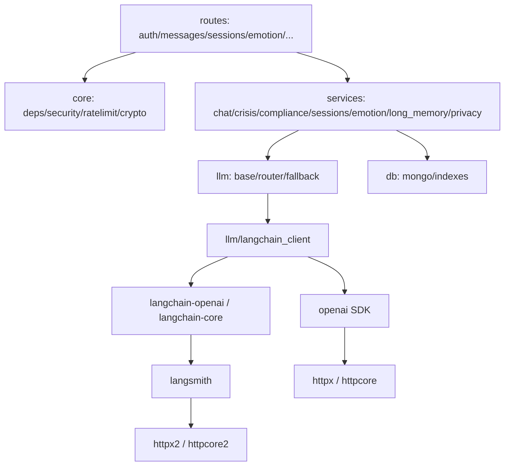

# 全仓代码审查报告（2026-11-11）

> 审查日期：2026-11-11
> 审查对象：`main` HEAD `eda4ac6`（CI run 43000162267 全绿）
> 审查性质：全仓只读审查（按功能域，不按 diff）
> 审查方式：干净快照 + 全新 venv 实跑；源码取证 + 双人独立验证
> 工具：`trae-remote-official:code-review-report-plugin:review-code-report`（改动导读 / 问题证据 / 分级）
> 　　　`trae-remote-official:brooks-lint:brooks-health`（架构 / 债务 / 测试健康度）
> 约束：未修改业务代码、未提交、未推送、未改动 `.env`

---

## 一、结论

**8 项历史上线阻断已全部按代码实际行为修复，且在后续提交中未被回退。** 干净快照上质量门全绿：
`ruff check .` 通过，`1128 passed, 1 skipped`，小程序 12 个 JS 全部通过，文档事实校验 4/4 通过。

但全仓取证新发现 **2 项阻断** 与 **5 项上线前应做** 项：

- **B-9（阻断）** 软删除用户再次登录返回 500，且“30 天内可登录恢复”从未接线。
- **B-10（阻断）** 小程序流式回调不校验 HTTP 状态；`stream_enabled=false` 或 401 时回复被丢弃，界面显示伪造的「我在听。」。
- 应做项集中在迁移脚本失败不设退出码、物理删除调度依赖启动时连通、CI 数据库用例可静默跳过、密钥轮换无防护、CI 评估门无 secret 时 SKIP。

按两套工具的共同指向，**最高优先级是 B-9、B-10 与 CI 静默跳过**：它们同时被代码审查与 Brooks 架构/测试视角命中。

整体就绪度：**质量门与历史修复可信，但当前仍不宜上线**。修掉 B-9、B-10 并完成 R-1～R-5 后，可进入发布候选。

---

## 二、审查方式与证据边界

### 2.1 干净快照

```bash
git worktree add /tmp/xinyu-review-eda4ac6 eda4ac6
python3.12 -m venv /tmp/xinyu-review-venv-eda4ac6
/tmp/xinyu-review-venv-eda4ac6/bin/pip install -r backend/requirements-dev.txt
```

### 2.2 实际质量门输出

```text
$ ruff check .
All checks passed!

$ pytest -q
SKIPPED [1] tests/test_ratelimit_redis.py:170: 未设置 REDIS_TEST_URL，跳过真 Redis 集成测试
1128 passed, 1 skipped, 1 warning

$ find miniprogram -name '*.js' -not -path '*/node_modules/*' -print0 | xargs -0 -n1 node --check
（12 个文件，全部通过）

$ python scripts/check_docs_facts.py
[1/4] 依赖声明：33 处，失败 0
[2/4] 测试基线：实际 1128 passed / 1 skipped / 共 1129 项，失败 0
[3/4] 命令与路径：20 处，失败 0
[4/4] 相对链接：18 处，失败 0
```

**与 CI 数字的差异来源**：CI backend job 设置了 `REDIS_TEST_URL`，`test_ratelimit_redis.py` 的真 Redis 用例会真实执行，因此为 `1129 passed`；本地未设置时为 `1128 passed, 1 skipped`。两者是同一套用例的口径差，不是缺失。README 与 `backend/README.md` 当前均已写明该口径。

### 2.3 证据标准

- 每条结论都给出 `file:line` 与可复现路径；运行期结论均在快照上实跑。
- 所有候选问题由两名独立验证者分别核对存在性、行号与严重度；保留 2/2 一致项，1/2 项标注分歧。
- 未做真实第三方联调、真机运行、容量压测与密钥轮换演练，相关结论已在第十节标注边界。

---

## 三、8 项历史阻断回验

> 不采信提交信息，逐项按当前代码行为确认；同时检查后续提交是否改回。

| 编号 | 内容 | 结果 | 代码行为证据 |
|---|---|---|---|
| B-1 | 危机词库补缺 | 已修复，未回退 | `crisis_data.py:24-30` 新增「自尽 / 就去死 / 一死了之 / 想离开人世 / 不想再活 / 不活了」；实跑 `我不活了`、`我今晚就去死`、`我要自尽`、`我想一死了之`、`我想离开人世`、`我不想再活了`、`我要去死` 全部 `high`；`你去死`、`爷爷去年离开人世` 仍为 `none` |
| B-2 | 生产强制 `ENV=prod`、关 mock | 已修复，未回退 | `docker-compose.yml` 的 `api.environment` 显式 `ENV: prod`；`.env.example:8` 改 `ENV=prod`、`WX_MOCK_LOGIN=false`；`config.py` 在 prod 下对 mock 登录 fail-fast |
| B-3 | 隐私同意服务端强制 | 已修复，未回退 | `core/deps.py:27-39` 新增 `get_consented_user`；`sessions/messages/emotion/memory/practices/speech/caring` 业务路由全部改用该依赖，例外只有 `/auth`、`/health`、`/crisis/resources`、`/users/me`、consent 与删除 |
| B-4 | 会话标题加密落库 | 已修复，未回退 | `chat.py:134-136` 写入用 `encrypt_optional_text`；`sessions.py:23/45/98/127` 读取解密；`privacy.py:90` 导出解密；迁移脚本含 `sessions.title` 且按 `is_encrypted` 幂等跳过 |
| B-5 | 代理后登录限流取真实 IP | 已修复，未回退 | `Dockerfile:24` 启动加 `--proxy-headers`，`compose` 设 `FORWARDED_ALLOW_IPS=172.28.0.0/16`；uvicorn 0.54 的 `_TrustedHosts` 支持 CIDR（实跑 `172.28.0.5` 命中、`1.2.3.4` 不命中）；`auth.py` 仍用 `request.client.host`，链路闭合 |
| B-6 | 危机链路解耦 DB | 已修复，未回退 | `crisis.py:522-537` 资源读取包 try 并回退 `FALLBACK_RESOURCES`；`record_risk_event` 写入失败只记日志；`messages.py:80-84` 的 `prepare_turn` 异常走 `_degraded_payload`，仍下发热线而非 500 |
| B-7 | 合规规则补缺 | 已修复，未回退 | `compliance.py` 的 `_NAME_VERB_RE` 含「叫/称作/算作」、`_DISORDERS` 含裸「双相」、疗效规则覆盖「能治好/吃点药就好」；实跑 8 条原漏拦样例全部命中，`你有点焦虑`、`抑郁症很常见`、`我有个朋友得了抑郁症`、`你不是抑郁症`、`按医嘱服药`、`你一定会好起来的` 仍不误报 |
| B-8 | 小程序 apiBase 可配置 | 已修复，未回退 | `miniprogram/config.js` 按 develop/trial/release 三套注入；`project.config.json` 的 `urlCheck` 为 `true` |

**结论**：8 项全部保持修复状态，没有在后续提交中被改回。

---

## 四、新发现：阻断（必须修才能上线）

### B-9 软删除用户再次登录返回 500，恢复承诺未实现

**位置**

- [users.py](backend/app/services/users.py#L12-L44)
- [indexes.py](backend/app/db/indexes.py#L19-L21)
- [privacy.py](backend/app/services/privacy.py#L227-L245)

**行为**

`get_or_create_by_openid` 只按 `{openid, deleted_at: None}` 查找；软删除记录不参与查找，必然走到 `insert_one`。`openid` 是唯一索引，软删除文档仍占用该 openid，于是插入抛 `DuplicateKeyError`，经全局异常处理器变成 500/9999。

`privacy.recover_user` 已实现，但全仓没有任何调用点（grep 只命中定义），因此“删除后 30 天内登录可撤销”从未接线。

**触发条件**：用户调用过 `DELETE /api/v1/users/me/data`，随后用同一微信账号重新登录。

**影响**：该类用户无法登录（500）；若未建唯一索引，则静默生成第二个用户，旧会话、情绪与记忆在恢复期内全部不可见。两条路径都与隐私文档的承诺不一致。

**修法**：登录时先按 openid 查含软删除的记录，命中则 `recover_user` 清空 `deleted_at`；恢复期已过则先物理删除再建号。补三类用例：恢复期内登录成功、恢复期外建新号、并发登录不重复。

**验证**：2/2 验证者确认（唯一索引成立的前提是执行过 `scripts/init_db`，生产部署清单包含该步）。

---

### B-10 小程序流式不校验 HTTP 状态，回复被丢弃并显示「我在听。」

**位置**

- [sse.js](miniprogram/utils/sse.js#L94-L118)
- [chat.js](miniprogram/pages/chat/chat.js#L376-L379)、[chat.js](miniprogram/pages/chat/chat.js#L434-L440)
- [messages.py](backend/app/api/routes/messages.py#L114-L130)

**行为**

`sse.js` 的 `success` 回调只解析 chunk 缓冲，从不读取 `statusCode`。当后端返回普通 JSON（`stream_enabled=false`，或鉴权失败返回 401）时，响应里没有 `event:`/空行结构，解析出 0 个事件；`chat.js` 的 `onComplete` 仍调用 `finishTurn(false)`，而 `finishTurn` 在文本为空时回落为「我在听。」。

**实测**：`stream_enabled=false` 返回 200 JSON `{code:0,data:{assistant_reply,...}}`，模拟 `sse.js` 解析得到 0 个事件，落到 `onComplete → finishTurn`，界面显示「我在听。」；401 的 JSON 同样静默。同轮危机卡片一并丢失。

**影响**：所有走流式路径的用户在该状态下丢失当轮回复，界面给出与事实不符的占位语；危机提示无法展示。

**修法**：`success` 先判 `statusCode`，非 2xx 交给 `onError` 走既有 401 刷新/重登链路；2xx 但无任何事件时把原始 JSON 当非流式响应处理。

**验证分歧**：一位验证者判阻断，另一位认为仅在 `stream_enabled=false` 或令牌失效时触发，属“开关触发即阻断”，保留 1/2 分歧标注。

---

## 五、新发现：上线前应做

| 编号 | 问题 | 位置 | 可复现证据 | 影响与修法 |
|---|---|---|---|---|
| R-1 | 加密迁移失败仍 exit 0 | [migrate_encrypt_sensitive_fields.py](backend/scripts/migrate_encrypt_sensitive_fields.py#L111-L136) | 缺密钥 / 连不上库 / 抽样解密失败三处只 `print` 后 `return`，入口无 `sys.exit` | 运维与 CI 把失败当成功，历史明文未迁移且无阻断信号；改为返回布尔并 `sys.exit(1)` |
| R-2 | 物理删除调度只在启动瞬间连通时创建 | [main.py](backend/app/main.py#L43-L47)、[mongo.py](backend/app/db/mongo.py#L16-L31) | 仅 `mongo.is_connected` 为真才 `create_task`；连接失败不重连 | Mongo 稍慢就绪即导致本进程永不执行物理删除；调度内部等待连接或周期重试 |
| R-3 | CI 的 Mongo 无 healthcheck，集成测试可静默跳过 | [ci.yml](.github/workflows/ci.yml#L14-L18)、[conftest.py](backend/tests/conftest.py#L48-L57) | 仅 redis 配了 healthcheck；连接失败时夹具批量 skip，pytest 仍 exit 0 | “CI 全绿”不代表数据库链路被验证；加 healthcheck 或前置连接断言 |
| R-4 | 密钥轮换/缺失无防护 | [crypto.py](backend/app/core/crypto.py#L60-L100)、[privacy.py](backend/app/services/privacy.py#L100-L130) | 信封只有 iv/ct/tag，无 key 版本；无密钥 `return ""`，换钥抛 `InvalidTag` 且调用处无 try | 会话列表/导出 500 或静默空数据；加 key 版本 + 多密钥解密 + 字段级降级 |
| R-5 | CI 评估门无 secret 时 SKIP 且 exit 0 | [ci.yml](.github/workflows/ci.yml#L92-L107) | 评估脚本打印 SKIP 后 `return 0` | “CI 通过”易被误读为评估达标；在验收口径显式标注，或有 secret 的分支必须留档 |

---

## 六、新发现：上线后可迭代

| 编号 | 问题 | 位置 | 说明 |
|---|---|---|---|
| I-1 | 重进会话时高危卡片可能无热线 | [app.js](miniprogram/app.js#L21-L26)、[chat.js](miniprogram/pages/chat/chat.js#L268-L270) | 启动拉取 `/crisis/resources` 失败留空缓存；卡片仍有固定 120/110 文案，但缺本地热线 |
| I-2 | 发送失败清空输入且不回填 | [chat.js](miniprogram/pages/chat/chat.js#L305-L316)、[chat.js](miniprogram/pages/chat/chat.js#L397-L410) | 弱网下长文本丢失 |
| I-3 | 上传接口无 401 刷新 | [api.js](miniprogram/utils/api.js#L156-L186) | 仅录音用户令牌过期后持续失败 |
| I-4 | `/health` 在 80 端口明文暴露且无限流 | [nginx.conf.template](backend/nginx/nginx.conf.template#L63-L65)、[health.py](backend/app/api/routes/health.py#L16-L22) | 返回 env/version/db，敏感度低但违反“80 只跳转”注释 |
| I-5 | 治理文档的 JS 门只查首文件 | [repo-governance.md](docs/repo-governance.md#L108) | 实测 `node --check a.js b.js` 第二个文件报错仍 exit 0；应为 `-exec ... {} \;` 或 `xargs -n1` |
| I-6 | 日志页用 UTC 日期比 CST 记录 | [logs.js](miniprogram/pages/logs/logs.js#L115) | CST 00:00–07:59 的当天打卡被判为非今天 |
| I-7 | `hit_read_rate` 定义但无调用 | [ratelimit.py](backend/app/core/ratelimit.py#L133) | 读接口实际只有 nginx 按 IP 限流，与“用户级读限流”口径不一致 |
| I-8 | 镜像 tag 浮动、nginx 无健康依赖 | [Dockerfile](backend/Dockerfile#L1)、[docker-compose.yml](backend/docker-compose.yml#L28-L33) | 构建不可复现；冷启动可能 502 |
| I-9 | 录音监听器 `onUnload` 未 off | [chat.js](miniprogram/pages/chat/chat.js#L110-L155) | 全局单例下重复注册为覆盖而非累加，实际影响低 |
| I-10 | 第三方转述仍判高危 | `crisis.py` 词库 | 实测「我室友说他想死」→ `high`；值班人收到噪信，属已知误报，需人称/转述判断 |

---

## 七、LangChain 迁移专项

### 7.1 `max_tokens` 还原覆盖

- 适配层在 [langchain_client.py](backend/app/llm/langchain_client.py#L41-L45) 覆写 `_get_request_payload`，把 `max_completion_tokens` 改回 `max_tokens`。
- 实跑验证（离线构造，不发网络）：

```text
payload keys: ['messages','model','stream','temperature','max_tokens']
max_tokens= 400   max_completion_tokens= None
```

- `ainvoke` 与 `astream` 都经过同一个 `_get_request_payload`，因此 4 个调用点（`chat.py:213/251`、`emotion.py:194`、`long_memory.py:223`）全部覆盖；项目未使用 `with_structured_output` 等旁路。

### 7.2 异常包装与 `__cause__`

- [zhipu.py](backend/app/llm/zhipu.py#L34-L60) 与 `qwen.py` 均 `raise RuntimeError(...) from exc`，原始异常保留在 `__cause__`。
- [fallback.py](backend/app/llm/fallback.py#L53-L60) 在备用也失败时 `raise primary_exc from backup_exc`，既保持调用方看到的仍是主异常，又保留备用原因链。
- `asyncio.CancelledError` 是 `BaseException`，不会被 `except Exception` 吞掉，取消语义未变。

### 7.3 `max_retries=0` 是否压住 SDK 隐式重试

- 实跑：`c.root_async_client.max_retries == 0`，`c.root_client.max_retries == 0`。
- 因此重试只保留在调用层（裸 provider 2 次、`FallbackProvider` 1 次），不会出现 SDK × 上层 × 主备相乘放大。

### 7.4 双 HTTP 栈的实际影响

- 实测 `langsmith 0.14.17` 的元数据：`Requires-Dist: httpx2<3,>=2`；venv 中同时存在 `httpx`（704 KB）与 `httpx2`（988 KB）+ `httpcore2`（728 KB）。
- 影响是**依赖面与安全补丁面扩大一套**，但本项目不启用 LangSmith，`httpx2` 只在 `langsmith` 导入链上存在，不参与模型请求。属于可接受的结构性成本，需在依赖扫描中同时关注两套栈。

### 7.5 依赖增长

- 实测新增包目录合计约 **45 MB**：`openai` 19 MB、`langsmith` 11 MB、`langchain_core` 5.5 MB、`tiktoken` 2.9 MB、`zstandard` 1.9 MB、`langchain_openai` 1.3 MB，其余约 3 MB。
- 与迁移计划中的“约 50 MB”一致；Docker 镜像增长同量级。

### 7.6 `app/llm` 之外是否越界

- 全仓 grep + `test_llm_boundary.py` 静态扫描：`langchain*` 只出现在 `backend/app/llm/` 内。边界成立。
- 业务层仍只依赖 `LLMProvider` 接口与工厂，危机、合规、记忆、SSE 不经过 LangChain。

### 7.7 密钥是否可能随异常或日志外泄

- 异常包装只拼接 `str(exc)`。OpenAI SDK 的状态异常文本为 `Error code / body`，不含 `Authorization` 头；连接异常只含 URL。**未发现密钥进入异常文本的路径**。
- 残余风险：上游 400 响应体可能回显请求片段（含用户消息），而 `RuntimeError` 会保留原文。当前 `chat.py` 的降级日志只记状态、不打印异常正文，因此未构成实际泄露；后续若新增 `logger.exception`，需脱敏。

### 7.8 专项结论

迁移在功能语义上是**等价替换**：字段名、重试、超时、异常传播、主备切换与流式语义均保持。主要代价是依赖体积与第二套 HTTP 栈，均不构成阻断。

---

## 八、功能域逐域结论

| 功能域 | 结论 | 关键证据 |
|---|---|---|
| 危机判定 | 词库缺口已补，DB 故障下有兜底；仍有转述误报 | `crisis_data.py:19-80`、`crisis.py:460-537`；实跑 10 条正反样例 |
| 合规过滤 | 诊断判断词、裸病名、疗效句式已补，正反样例均通过 | `compliance.py`；实跑 16 条样例 |
| 长期记忆 | 危机内容不抽取；解密仍在 try 外（脏数据可阻断当轮） | `long_memory.py:329/337`；建议把解密与排序整体包 try |
| LLM 层 | 边界成立、语义等价；依赖 +45 MB、双 HTTP 栈 | 第七节 |
| 会话与隐私 | 标题全链路加密、同意强制生效；软删除恢复断裂（B-9） | `deps.py`、`sessions.py`、`users.py` |
| 数据加密与迁移 | 迁移幂等、可 dry-run；失败不设退出码（R-1）；轮换无版本（R-4） | `migrate_encrypt_sensitive_fields.py`、`crypto.py` |
| 编排与 nginx | ENV=prod 与代理头已修；/health 明文、健康依赖弱 | `docker-compose.yml`、`Dockerfile`、`nginx.conf.template` |
| 小程序端 | 发布地址可配置；流式错误路径断裂（B-10），另有多项体验缺陷 | 第四、六节 |
| 测试与语料 | 1128 通过，危机/合规/记忆语料回归完整；缺 B-9/B-10 用例 | `tests/`，见第九节 |
| CI 与文档 | 四 job 齐全、文档事实校验通过；Mongo 与 eval 可静默转绿（R-3/R-5） | `ci.yml`、`check_docs_facts.py` |

---

## 九、Brooks-Lint 健康仪表盘

**Mode:** Health Dashboard
**Scope:** 全仓（backend/app、backend/tests、miniprogram、deploy、docs）@ `eda4ac6`
**Composite Score:** 87/100
**Trend:** 91 → 87（−4，对比 2026-10-29 同模式）

| Dimension | Score | Top Finding |
|---|---|---|
| Code Quality | — | 本轮无 diff，跳过并重分配权重 |
| Architecture | 90/100 | 模型层边界成立，但引入第二套 HTTP 栈 |
| Tech Debt | 80/100 | 软删除恢复能力未接线（Domain Model Distortion） |
| Test Quality | 90/100 | 缺 B-9/B-10 用例；CI 数据库用例可静默跳过 |

权重按 PR 跳过规则重分配：Architecture 0.40、Debt 0.33、Test 0.27。

### 模块依赖图（核心）



### Top Findings

**🔴 Critical — Domain Model Distortion：删除与恢复的领域语义只实现了一半**
Symptom: `privacy.recover_user` 存在但零调用；登录查询过滤 `deleted_at=None` 后直接插入，撞 openid 唯一索引。
Source: *Domain-Driven Design* — Model Integrity / *Working Effectively with Legacy Code* — 未接线的能力等于不存在。
Consequence: 用户行使删除权后无法再登录，或静默产生重复账号；合规承诺不可兑现。
Remedy: 把“恢复期”建模为登录前置状态机，并补端到端用例。

**🟡 Warning — Knowledge Duplication：两套请求/鉴权语义**
Symptom: `api.js` 的 `request()` 有 401 刷新/重登/重放，`sse.js` 与 `uploadFile` 各自复制了一份简化逻辑，且都缺状态码判断。
Source: *The Pragmatic Programmer* — DRY / *A Philosophy of Software Design* — 信息泄漏。
Consequence: 同一错误在三处表现不一致，流式路径直接丢回复。
Remedy: 抽一个共享的“发送 + 鉴权 + 状态码”层，SSE 只负责帧解析。

**🟡 Warning — Dependency Disorder：双 HTTP 栈**
Symptom: `langchain-core → langsmith → httpx2`，与既有 `openai → httpx` 并存。
Source: *Clean Architecture* — 依赖方向与边界 / *Software Architecture: The Hard Parts* — 依赖扇入成本。
Consequence: 安全补丁面与依赖审计面翻倍。
Remedy: 保持 `app/llm` 为唯一入口；依赖扫描同时覆盖两套栈；如无 tracing 需求，评估锁定不带 langsmith 的版本。

**🟡 Warning — Test Brittleness：关键失败路径无自动化**
Symptom: 软删除再登录、SSE 非 2xx、迁移失败退出码均无用例。
Source: *xUnit Test Patterns* — Test Coverage / *How Google Tests Software* — 风险驱动测试。
Consequence: 本次两项阻断都绕过了 1128 条用例。
Remedy: 每条阻断补最小复现用例，并纳入 CI。

**🟡 Warning — Change Propagation：`chat.py` 成为协调枢纽**
Symptom: 单文件同时依赖危机、合规、记忆、情绪、内容安全、告警与 SSE 收尾。
Source: *A Philosophy of Software Design* — Complexity / *Refactoring* — Divergent Change。
Consequence: 任一子链路调整都要改同一文件，回归面大。
Remedy: 保持确定性链路优先，逐步把“轮次准备/生成/收尾”拆成可独立测试的步骤。

---

## 十、两套工具共同指向（优先级最高）

| 问题 | 代码审查 | Brooks 视角 | 结论 |
|---|---|---|---|
| 软删除恢复断裂 | B-9（阻断） | Domain Model Distortion（Critical） | 两套工具均判最高优先级，**先修** |
| 小程序流式错误处理 | B-10（阻断） | Knowledge Duplication（Warning） | 同一根因：请求/鉴权语义被复制，**与 B-9 同批修** |
| CI 可静默转绿 | R-3 / R-5（应做） | Test Quality 90 分的主因 | “全绿”不可作为上线唯一依据，需加就绪断言 |
| 模型层依赖增长 | 专项 7.4/7.5 | Dependency Disorder（Warning） | 非阻断，但需纳入依赖治理 |

---

## 十一、限制与未覆盖

1. 未使用真实微信、智谱、DashScope 凭据做第三方联调；LangChain 主通道仅做离线请求体与客户端参数验证，备用通道未启用。
2. 小程序未在真机运行，SSE 与录音相关结论基于代码路径与 `wx.request` 行为推导，并由静态实验复核。
3. 未做容量压测、多实例部署、密钥轮换演练与灾备切换。
4. B-9 的 500 成立前提是已执行 `scripts/init_db` 建立 openid 唯一索引；未建索引时表现为静默重复账号，同样不可恢复。
5. 危机词库与合规规则的语义边界仍需临床/心理与法务专业复核；本轮只验证“已覆盖表达 + 已列反例”，不能证明召回率 ≥95%。
6. 本报告结论只针对已提交基线 `eda4ac6`。审查期间工作区存在**他人未提交改动**（`users.py` 的 P-15、`fallback.py`、`main.py` 的 purge 调度、`long_memory.py` 的解密兜底、`docker-compose.yml` 的健康依赖、`docs/repo-governance.md` 的 JS 门命令等），未纳入本次取证；其中部分与本报告 R-2、I-5、I-8 同级问题相关，合并前需以最终提交重新确认。

---

## 十二、建议的修复顺序

1. **B-9** 软删除登录恢复（含唯一索引冲突路径）。
2. **B-10** 流式状态码与错误分流（同时修复 I-3 的 401 刷新）。
3. **R-1 / R-2** 迁移退出码与物理删除调度。
4. **R-3 / R-5** CI 数据库就绪断言与评估门口径。
5. **R-4** 密钥版本与降级策略（上线前完成 runbook）。
6. 其余可迭代项按版本排期。
