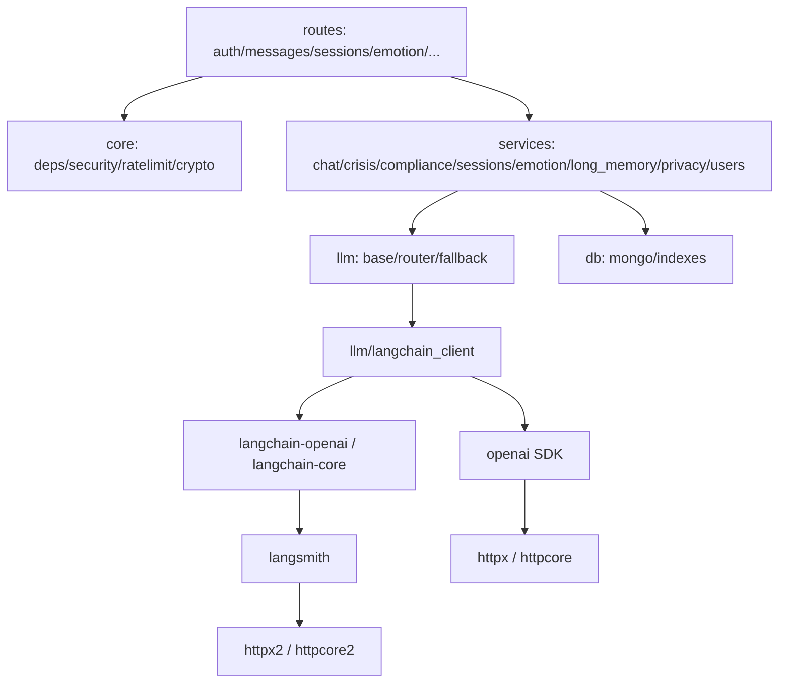

# 第二轮全仓代码审查报告（2026-11-11）

> 审查日期：2026-11-11
> 审查对象：`main` HEAD `c285a95`（P2-⑤ 提交）
> 审查性质：全仓只读审查（按功能域，不按 diff）；修复后基线复检
> 审查方式：干净 worktree 快照 + 全新 venv 实跑；双人独立验证候选问题
> 工具：`trae-remote-official:code-review-report-plugin:review-code-report`
> （reviewId `review-403aa135-67a0-4bae-b433-e63b1493aa48`，251 文件 / 7 项发现）
> 　　　`trae-remote-official:brooks-lint:brooks-health`（架构 / 债务 / 测试健康度）
> 约束：未修改业务代码、未提交业务代码、未推送、未改动 `.env`

---

## 一、结论

**可以上线。** 上一轮的 10 项阻断（B-1..B-10）已逐条按当前代码行为回验通过，本轮未发现新的阻断项；
干净快照上四项质量门全绿，CI 四个 job 的本地等价命令也全部跑通。

上线前还剩 **2 项非代码动作**，不构成代码阻断：

1. 发布 runbook 固化密钥轮换顺序：先配 `DATA_ENCRYPTION_KEY_PREVIOUS` 再切新钥（见 C-1）；
2. 明确评估门对 fork PR 的策略（见 C-6），内部发布不受影响。

整体就绪度：**阻断清零，质量门可信，可进入发布候选并执行上线清单。** 剩余 7 项发现均为
`major × 1` 与 `minor × 6`，建议按本报告顺序排入上线后第一个迭代。

---

## 二、审查方式与实跑证据

### 2.1 干净快照

```bash
git worktree add /tmp/xinyu-r2-c285a95 c285a95
python3.12 -m venv /tmp/xinyu-venv-r2-c285a95
/tmp/xinyu-venv-r2-c285a95/bin/pip install -r backend/requirements-dev.txt
```

### 2.2 质量门实际输出（快照，非工作区）

```text
$ ruff check .
All checks passed!

$ pytest -q
1138 passed, 1 skipped, 1 warning in 4.89s

$ REDIS_TEST_URL=redis://localhost:6379/1 pytest -q     # CI backend job 口径
1139 passed in 5.3s

$ find miniprogram -name '*.js' -not -path '*/node_modules/*' -print0 | xargs -0 -n1 node --check
13 个文件全部通过（12 个源文件 + 1 个测试文件）

$ node --test miniprogram/tests/*.test.js
4 passed / 0 failed

$ python scripts/check_docs_facts.py
[1/4] 依赖声明：失败 0
[2/4] 测试基线：实际 1138 passed / 1 skipped / 共 1139 项，失败 0
[3/4] 命令与路径：失败 0
[4/4] 相对链接：失败 0
```

**口径说明**：本地未设 `REDIS_TEST_URL` 时为 `1138 passed, 1 skipped`（skip 为真 Redis 集成）；
CI backend job 设置该变量后为 `1139 passed`。README、`backend/README.md` 与 `AGENTS.md` 已同步该口径，
文档事实门禁通过。

**过程纠偏**：首次取证时两个 pytest 进程并行跑在同一个 `xinyu_test` 库上，互相清库产生了
13～16 条伪失败（`用户不存在或已注销`）。改为串行后全绿。该现象本身说明测试库是共享可变状态，
已单列为 C-7。

### 2.3 修补项的本地等效验证

```text
$ DATA_ENCRYPTION_KEY= python -m scripts.migrate_encrypt_sensitive_fields --dry-run
[FAIL] DATA_ENCRYPTION_KEY 未配置：拒绝执行…          exit=1
$ DATA_ENCRYPTION_KEY=<32B> MONGODB_URI=mongodb://127.0.0.1:27099 … --dry-run
[FAIL] MongoDB 未连接…                                exit=1

$ CI=true MONGODB_URI=mongodb://127.0.0.1:27099 pytest -q tests/test_chat.py
ERROR … Failed: CI 环境 MongoDB 不可用：集成用例不得静默跳过…
11 errors in 3.15s                                     exit=1
```

GitHub Actions 本身无法在本地复现，以上用「缺密钥」「断库」「CI 环境变量 + 不可达 Mongo」
三种输入验证了脚本与夹具的真实退出行为，不是对 YAML 的推测。

### 2.4 证据标准

- 每条结论给出 `file:line` 与可复现路径；运行期结论在快照上实跑。
- 候选问题由两名独立验证者分别核对存在性、行号与严重度；保留 2/2 一致项，1/2 项标注分歧，
  0/2 项排除（本轮排除 1 项，见 5.2）。
- 未做真实微信/模型联调、真机运行、容量压测与真实密钥轮换演练，边界见第十一节。

---

## 三、10 项阻断逐条回验

> 不采信提交信息，按当前代码行为确认，并检查修复是否引出回归。

| 编号 | 内容 | 结果 | 代码行为证据 |
|---|---|---|---|
| B-1 | 危机词库补缺 | 已修复，未回退 | `crisis_data.py:24-30`；实跑「我不活了 / 我今晚就去死 / 我要自尽 / 我想一死了之 / 我想离开人世 / 我不想再活了 / 我要去死」全部 `high`；「你去死 / 爷爷去年离开人世 / 你有点焦虑」仍非 `high` |
| B-2 | 生产强制 `ENV=prod`、关 mock | 已修复，未回退 | `docker-compose.yml` 的 `api.environment` 显式 `ENV: prod`；`.env.example` 为 `ENV=prod`、`WX_MOCK_LOGIN=false`；`config.py` 在 prod 下对 mock 登录 fail-fast |
| B-3 | 隐私同意服务端强制 | 已修复，未回退 | `core/deps.py` 的 `get_consented_user`；业务路由统一改用该依赖，例外只有 `/auth`、`/health`、`/crisis/resources`、`/users/me`、consent 与删除 |
| B-4 | 会话标题加密落库 | 已修复，未回退 | 写入侧 `encrypt_optional_text`；读取侧 `sessions.py` 解密；`privacy.py` 导出解密；迁移脚本覆盖 `sessions.title` 且幂等 |
| B-5 | 代理后登录限流取真实 IP | 已修复，未回退 | `Dockerfile` 启动加 `--proxy-headers`，compose 设 `FORWARDED_ALLOW_IPS`；uvicorn 支持 CIDR；`auth.py` 仍用 `request.client.host` |
| B-6 | 危机链路解耦 DB | 已修复，未回退 | 资源读取 try + `FALLBACK_RESOURCES`；`record_risk_event` 失败只记日志；`prepare_turn` 异常走 `_degraded_payload`，仍下发热线而非 500 |
| B-7 | 合规规则补缺 | 已修复，未回退 | 名称/疾病/疗效规则命中 5 条正例；「你有点焦虑 / 抑郁症很常见 / 我有个朋友得了抑郁症 / 你不是抑郁症 / 按医嘱服药 / 你一定会好起来的」不误报 |
| B-8 | 小程序 apiBase 可配置 | 已修复，未回退 | `miniprogram/config.js` 按 develop/trial/release 三套注入；`project.config.json` 的 `urlCheck` 为 `true` |
| B-9 | 软删用户重登 500 | 已修复，未回退 | `users.py:21-73` 三分支：活跃直取、恢复期内 `recover_user` 后回读、过期 `purge_user_data` 后新建；`DuplicateKeyError` 回读兜底。`test_user_recovery.py` 三用例覆盖 |
| B-10 | 流式不校验状态码 | 已修复，未回退 | `sse.js:118-143` 先判非 2xx，再判非事件流；`chat.js` 对 `-2` 非流式降级、`-3` 按 JSON 渲染、无增量显式报错；`sse-status.test.js` 覆盖 401/500/200 JSON/正常流 |

**结论**：10 项全部保持修复状态，未在后续提交中回退；未发现「修 A 破 B」。

---

## 四、P2 五项回验

| 项 | 结果 | 证据 |
|---|---|---|
| R-1 迁移失败退出码 | 生效 | `migrate_encrypt_sensitive_fields.py` 返回 0/1 + `sys.exit`；实跑缺密钥、断库均 `exit=1`。**注意**：该项无自动化用例，回归靠代码与手工验证（见 C-4） |
| R-2 purge 调度启动条件 | 生效 | `main.py` 只按 `data_purge_enabled` 建任务；调度内部等待连接并周期重试，不再依赖启动瞬间连通；`test_privacy.py` 有守护用例。**残余**：首跑延迟一个周期（见 C-3） |
| R-3 CI Mongo healthcheck | 生效 | `ci.yml` backend 与 docs job 均有 mongosh ping healthcheck；`conftest.py` 在 `CI` 下 Mongo 不可用即 `pytest.fail`；实跑得到 11 errors / `exit=1` |
| R-4 密钥版本化 | 生效 | 信封写 `key_id`；解密当前钥失败回退 `DATA_ENCRYPTION_KEY_PREVIOUS`；历史无 `key_id` 信封兼容；`test_crypto.py` 覆盖无旧钥显式失败。**残余**：读取侧无字段级降级（见 C-1） |
| R-5 eval 门缺 secret | 生效 | 两脚本 `--require-key` 打印 FAIL 并 `return 1`；CI 传参；`test_eval_gate_key.py` 断言退出 1。**代价**：fork PR 必红（见 C-6） |

---

## 五、本轮新发现

### 5.1 分级结论

| 编号 | 级别 | 问题 | 位置 |
|---|---|---|---|
| C-1 | major | 密钥轮换未配旧钥时，会话列表与数据导出整页 500 | [sessions.py](backend/app/services/sessions.py#L20-L27)、[privacy.py](backend/app/services/privacy.py#L84-L113)、[crypto.py](backend/app/core/crypto.py#L129-L141) |
| C-3 | minor | 到期物理删除首次要等满一个周期，频繁重启可能永不执行 | [privacy.py](backend/app/services/privacy.py#L282-L299) |
| C-4 | minor | 迁移抽样校验在目标集合为空时无条件通过 | [migrate_encrypt_sensitive_fields.py](backend/scripts/migrate_encrypt_sensitive_fields.py#L99-L109) |
| C-5 | minor | 响应缺 `Content-Type` 时，200 JSON 仍被当事件流解析 | [sse.js](miniprogram/utils/sse.js#L128-L143) |
| C-6 | minor | 评估门强制 secret，fork PR 必然失败 | [ci.yml](.github/workflows/ci.yml#L101-L123) |
| C-7 | minor | 软删重登用例在共享测试库留下 openid 唯一索引 | [test_user_recovery.py](backend/tests/test_user_recovery.py#L23-L34) |
| C-8 | minor | 语音上传不参与 401 刷新与重放 | [api.js](miniprogram/utils/api.js#L155-L190) |

### 5.2 C-1 密钥轮换缺字段级降级（major，2/2 确认，严重度 1 分歧）

- **行为**：`decrypt` 在当前钥解密失败且未配置 `DATA_ENCRYPTION_KEY_PREVIOUS` 时重新抛出；
  会话列表、重命名与数据导出在循环里直接调用，没有按记录/按字段捕获。
- **触发**：执行密钥轮换但漏配旧钥，库中存在旧钥密文。
- **影响**：一条旧密文即可让整页会话列表与导出返回 500，用户无法读取历史、无法行使导出权。
- **修法**：读取侧按记录捕获 `InvalidTag`，降级为明确占位并记日志；runbook 把「先配 previous」
  写成强制步骤。
- **分歧说明**：一名验证者判 major（整页不可用），另一名判 minor（仅运维漏配时触发）。保留分歧，
  按 major 排期。
- **为何不阻断上线**：首次部署只有一把钥，触发前提是主动轮换且漏配；已在本报告结论中作为
  上线前 runbook 动作列出。

### 5.3 被排除的候选

**C-2「账号恢复复活此前单独删除的会话」不成立。** 两名验证者均反证：`delete_session` 是物理删除
（`delete_many` 消息 + `delete_one` 会话），已单独删除的会话文档不存在；`sessions.deleted_at`
只由账号级 `erase_user_data` 写入，`recover_user` 恢复的正是被账号删除标记的那批，语义正确。

### 5.4 其余各项要点

- **C-3**：`run_purge_scheduler` 以 `await asyncio.sleep(interval)` 开头，默认 3600 秒；容器滚动重启
  或崩溃重启会重置计时，重启间隔短于一小时即永不清理。建议启动先扫一次，并暴露「上次清理时间」。
- **C-4**：`_verify_sample` 只取 `emotion_records.evidence`，空集合直接 `return True`；即使有样本，
  也可能是本次刚写入的，无法发现「与既有密文不同钥」。建议校验迁移前已存在的密文，无样本时 WARN。
- **C-5**：判断写成 `if (contentType && …)`，Content-Type 缺失时短路进入事件流分支，普通 JSON
  解析出 0 个事件，最终只给通用失败提示。建议把「缺失」也视为非事件流，并补一条用例。
- **C-6**：`--require-key` 把静默跳过改成显式失败是正确方向，但 GitHub 不向 fork PR 提供 secret，
  这类 PR 的 eval job 永远红。建议按事件类型区分内部/外部 PR，或在分支保护中只要求内部 PR。
- **C-7**：fixture 建 `users.openid` 唯一索引且不 drop；索引与生产 schema 一致，直接破坏很弱，
  但让测试结果依赖历史运行状态。建议 teardown 时 drop 或改用独立库。
- **C-8**：`uploadFile` 自行实现，401 只 reject，不刷新令牌；access token 过期后首次语音转写必失败一次。

---

## 六、LangChain 迁移专项重扫

| 检查项 | 结论 | 证据 |
|---|---|---|
| 迁移边界 | 成立 | 全仓 `langchain*` 只出现在 `backend/app/llm/`；`test_llm_boundary.py` 静态扫描兜底 |
| `max_tokens` 还原 | 成立 | `langchain_client.py` 覆写 `_get_request_payload`，`ainvoke`/`astream` 共用，4 个调用点全覆盖 |
| 重试放大 | 不存在 | `root_client`/`root_async_client.max_retries == 0`，重试只保留在裸 provider（2 次）与主备（1 次） |
| 异常链 | 成立 | provider 均 `raise … from exc`；`fallback` 保留主异常与备用原因链 |
| 取消语义 | 未变 | `CancelledError` 属 `BaseException`，不被 `except Exception` 吞掉 |
| 双 HTTP 栈 | 仍存在 | `langsmith → httpx2/httpcore2` 与 `openai → httpx/httpcore` 并存；本项目不启用 LangSmith，`httpx2` 不参与模型请求，属结构性成本 |
| 依赖版本 | 已收紧 | `requirements.txt` 对 `langchain-openai`、`langchain-core`、`openai` 使用精确版本，较上一轮更可复现 |
| 密钥泄露 | 未发现路径 | 异常文本只含状态与响应体，不含 `Authorization`；降级日志只记状态不打印正文 |

专项结论：迁移仍是**功能等价替换**，未发现新增阻断。

---

## 七、Brooks-Lint 健康仪表盘

**Mode:** Health Dashboard
**Scope:** 全仓（backend/app、backend/tests、miniprogram、CI、docs）@ `c285a95`
**Composite Score:** 92/100
**Trend:** 87 → 92（+5，对比 `eda4ac6` 同模式）

| Dimension | Score | Top Finding |
|---|---|---|
| Code Quality | — | 本轮无 diff，跳过并重分配权重 |
| Architecture | 94/100 | 模型层边界成立；双 HTTP 栈仍在；`chat.py` 编排扇出 6 个服务 |
| Tech Debt | 86/100 | 密钥轮换无字段级降级；清理调度首跑延迟 |
| Test Quality | 98/100 | 阻断项均有用例；仍有共享测试库状态耦合 |

权重按 PR 跳过规则重分配：Architecture 0.40、Debt 0.33、Test 0.27。

### 模块依赖图（核心）



依赖方向为 routes → services → core/db/llm，无反向引用、无环；`chat.py` 作为对话编排枢纽
扇出 6 个服务（告警、合规、内容安全、长期记忆、记忆、情绪），是本轮唯一的架构级提示。

### Top Findings

**🟡 Warning — Knowledge Duplication：解密没有统一的受保护入口**
Symptom: `decrypt` 被会话、消息、打卡、导出、记忆等 6 处直接调用，均未捕获 `InvalidTag`；
当前钥与历史密文不匹配时整页失败而不是单条降级。
Source: *A Philosophy of Software Design* — 信息泄漏 / *The Pragmatic Programmer* — DRY。
Consequence: 一次运维漏配（未设 previous）即放大为整页 500，用户无法读取或导出数据。
Remedy: 提供 `decrypt_or_placeholder` 并在读取侧统一使用；runbook 固化轮换顺序。

**🟡 Warning — Accidental Complexity：清理任务的启动语义与承诺不一致**
Symptom: 调度循环先睡满 3600 秒再扫描，重启即重置计时。
Source: *Release It!* — 启动期行为 / *Site Reliability Engineering* — 批处理可观测性。
Consequence: 频繁重启的实例可能永不执行物理删除，合规承诺无法兑现且无可观测信号。
Remedy: 启动先执行一次扫描，暴露「上次成功清理时间」指标。

**🟢 Suggestion — Test Brittleness：用例依赖共享库残留状态**
Symptom: 软删重登用例建唯一索引后不清理；两个 pytest 并行即互相清库。
Source: *xUnit Test Patterns* — 测试隔离 / *How Google Tests Software* — 测试可重复性。
Consequence: 结果依赖运行顺序与历史状态，排障成本上升。
Remedy: 每个用例自建自清 schema，或使用独立测试库。

**🟢 Suggestion — Coverage Illusion：流式错误分支缺一类响应**
Symptom: `sse-status.test.js` 覆盖 401/500/200 JSON/正常流，但没有「2xx 且无 Content-Type」。
Source: *How Google Tests Software* — 风险驱动测试。
Consequence: C-5 这类边缘响应的退化不会被用例发现。
Remedy: 补一条无响应头的 200 JSON 用例。

**🟢 Suggestion — Change Propagation：评估门策略分散在三处**
Symptom: `--require-key` 的语义同时由两个脚本、CI 两处传参与 `eval-gate.md` 约定。
Source: *Working Effectively with Legacy Code* — 变更点收敛。
Consequence: 调整门禁策略需要同步改 4 处，容易漏改。
Remedy: 把「是否要求密钥」收敛为单一开关，CI 只传一次。

---

## 八、两套视角的共同指向

| 问题 | 代码审查（插件） | Brooks 视角 | 优先级 |
|---|---|---|---|
| C-1 解密无降级 | 是（major） | 是（Knowledge Duplication，Warning） | 最高 |
| C-3 清理首跑延迟 | 是（minor） | 是（Accidental Complexity，Warning） | 高 |
| C-7 测试库污染 / 伪失败 | 是（minor） | 是（Test Brittleness） | 中 |
| C-5 缺 Content-Type 用例 | 是（minor） | 是（Coverage Illusion） | 中 |
| C-6 评估门策略分散 | 是（minor） | 是（Change Propagation） | 中 |
| 双 HTTP 栈 | 专项记录 | 是（Dependency Disorder） | 观察 |

两套工具都指向的 C-1 与 C-3 应优先处理；其余为体验与可维护性改进。

---

## 九、功能域逐域结论

| 功能域 | 结论 | 关键证据 |
|---|---|---|
| 危机判定 | 词库与兜底完好，转录述误报仍在（I-10） | 7 条正例全 `high`；「我室友说他想死」仍 `high` |
| 合规过滤 | 规则覆盖与反例均通过 | 5 条正例全命中，6 条反例无误报 |
| 对话与 SSE | 心跳、截断、断连续跑完好；错误分流正确 | 心跳 5s < 客户端 10s idle；`test_chat.py` 全通过 |
| 身份与隐私 | 三分支登录状态机成立；删除/恢复口径一致 | `users.py`、`privacy.py`、`test_user_recovery.py` |
| 加密与密钥 | 版本化与旧钥兜底成立；读取侧缺降级 | `crypto.py`、`test_crypto.py` |
| 记忆与情绪 | 解密已在 try 内，降级路径存在 | `long_memory.py` 读取包 try |
| 模型层 | 边界、payload、重试、异常链均成立 | `app/llm/`、`test_llm_boundary.py` |
| 小程序请求层 | 主链路状态码正确；上传缺 401 刷新 | `sse.js`、`api.js`、`chat.js` |
| CI 与门禁 | 四 job 本地等价可跑；两处策略副作用 | `ci.yml`、`conftest.py`、实跑退出码 |
| 部署与运维 | 健康依赖与代理头已修；镜像 tag 仍浮动 | `docker-compose.yml`、`Dockerfile` |

---

## 十、上线就绪自检

| 检查项 | 结果 |
|---|---|
| 阻断清零 | B-1..B-10 全部回验通过，无新阻断 |
| CI 四 job 与本地口径一致 | backend：本地 1138+1skip ↔ CI 1139（Redis 口径差）；miniprogram：13 JS + 4 用例；eval：缺 secret 显式失败；docs：4/4 通过 |
| README / `backend/README.md` / `AGENTS.md` 数字同步 | 已同步 1138/1139 口径，`check_docs_facts.py` 通过 |
| 危机与合规行为未改变 | 正反例实跑一致，词库只增不减 |
| SSE 协议未改坏 | 心跳、截断、断连落库均有既有用例并通过 |
| 工作区状态 | 审查全程只读，业务代码零改动 |

---

## 十一、证据边界

- 未使用真实微信、智谱、DashScope 凭据做第三方联调；评估门只验证了缺 secret 的失败路径。
- 小程序未在真机运行，流式与录音结论基于代码路径与 `node:test` 用例。
- 未做容量压测、多实例部署、真实密钥轮换演练与灾备切换。
- B-9 的 500 复现前提是已建立 openid 唯一索引；生产由 `scripts/init_db.py` 创建，本轮在测试库显式建索引复现。
- GitHub Actions 的实际 healthcheck 行为无法本地复现，已用三种等价输入验证脚本与夹具的退出行为（见 2.3）。
- 危机词库与合规规则的语义边界仍需临床与法务复核，本轮只验证已覆盖表达与既有反例。

---

## 十二、剩余工作与建议顺序

**上线前（非代码）**

1. 在发布 runbook 写明密钥轮换顺序：先配 `DATA_ENCRYPTION_KEY_PREVIOUS`，再切新钥与新版本号；
   确认全量重写后才移除旧钥。
2. 明确评估门对 fork PR 的策略（内部 PR 强制、外部 PR 标注 SKIP 原因），并写入 `docs/eval-gate.md`。
3. 上线后首日观察 purge 调度是否至少成功执行一次（当前首次在启动后 1 小时）。

**上线后第一个迭代（按优先级）**

1. C-1：读取侧按记录降级 + 统一受保护的解密入口。
2. C-3：启动即扫一次，暴露上次清理时间。
3. C-4：迁移校验改用迁移前已存在的密文，空样本输出 WARN。
4. C-7：测试 fixture 自建自清 schema，消除共享库状态耦合。
5. C-5 / C-8：补无 Content-Type 用例；上传复用 401 刷新重放。
6. 上一轮遗留 P3：I-1、I-2、I-3、I-4、I-6、I-7、I-9、I-10 未在本轮改动，按原报告保留。

> 本报告结论只针对已提交基线 `c285a95`；后续任何代码变更都需要重新取证。
