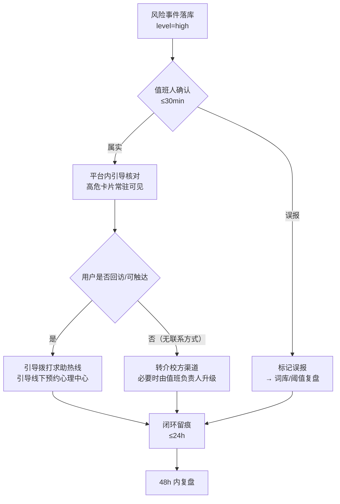

# 心屿 · 高危风险事件人工响应 SOP

| 项 | 内容 |
|---|---|
| 文档版本 | v0.1（草案） |
| 状态 | 待落地：值班名单、SLA 数值、校方联系人等占位项待 M2 / 运营补齐 |
| 定位 | 定义危机拦截（一票否决）命中 **high** 级风险事件后的**人工响应链**：值班人、响应时限、升级路径、留痕方式 |
| 适用范围 | 上线后（`v1.0.0`）运营 + 后端 + 校心理中心协作 |
| 关联文档 | `docs/improvement-roadmap.md`（M4）、`docs/privacy-policy.md`、`docs/crisis-lexicon-workflow.md`、`docs/crisis-recall-p5.md` |
| 对应缺口 | G11：风险事件仅落库审计，无值班与升级路径定义 → 一票否决抓到高危却无人响应＝责任风险 |

> 一句话：**技术侧负责「不漏报、可留痕」，人工侧负责「有人看、有人管、有升级」；本条 SOP 就是把这两侧接起来。**

---

## 一、目的与适用范围

1. **目的**：确保每一条 high 级风险事件都有明确 owner、明确时限、明确处置动作与可审计的留痕，避免「系统抓到了，但没人处理」。
2. **范围**：仅覆盖 `level=high` 的风险事件（mid 级不上报人工，见 §2.1）。
3. **不做什么**：本产品**不提供危机干预与心理治疗**，人工响应只做「确认、转介、留痕」三件事，不做诊断、不做治疗、不做临床判断。

---

## 二、触发条件（与代码现状对齐）

### 2.1 触发 high 的三条路径

| # | 路径 | `trigger` 字段 | 说明 |
|---|---|---|---|
| 1 | 一级强信号词库同步命中 | `lexicon` | 不调大模型，一票否决，直接 high |
| 2 | 二级语境词会话累计 ≥4 分升 high | `lexicon` | 单会话内累计，命中即升级 |
| 3 | 异步模型风险兜底判为高风险 | `model` | 本地词库未命中时由轻量模型补位 |

> 三条路径**均为 high 级同等对待**，人工响应不区分来源。

### 2.2 数据来源与现状约束

- 落库集合：`risk_events`（`user_id` · `session_id` · `level` · `trigger` · `matched` · `created_at`）。
- **值班人触达通道（M5 ③ 已落地）**：新 high 事件即时推送值班群——后端 `services/alerting.py` 经企业微信群机器人 webhook（`ALERT_WEBHOOK_URL`）通知，内容只含用户/会话 ID、级别与触发源（不含命中词与原文）；未配置 webhook 时仅记 warning 日志，此时回退 **A（低配）** 巡检方案：
  - **A（低配）**：值班人按班次**定时巡检** `risk_events`（见 §4 巡检节奏）；
  - **B（推荐，已实现）**：监控告警即时推送值班群（配置 `ALERT_WEBHOOK_URL` 即生效，同会话 10 分钟冷却去抖）。
- 只记元数据、不存对话原文（延续 P4 基线）：`matched` 仅存命中词，不含上下文原句。

### 2.3 触达手段的现实约束 ★

产品侧**不收集用户手机号/邮箱**（仅有 openid），因此人工**无法直接电联用户**。可用的用户侧触达手段有限：

| 手段 | 可用性 | 说明 |
|---|---|---|
| 用户侧一键拨打求助热线 | ✅ 已具备 | 危机卡片 4 条热线，用户主动拨打（最可靠） |
| 微信订阅消息推送 | ⏳ M4 阶段未具备 | 依赖 V3 主动关怀；且需用户订阅授权 |
| 校方渠道协助 | ⏳ 依赖 M2 | 需用户自愿暴露身份或学校侧依规介入 |
| 平台内提示（重进会话可见） | ✅ 已具备 | 高危卡片常驻，用户回访即见 |

> 结论：**人工响应在用户侧主要靠「转介 + 平台内提示」，不能承诺"打电话找到人"。** 该口径必须在 M1 提审应答中如实说明，三者讲同一套故事。

---

## 三、角色与职责

| 角色 | 职责 | 占位 |
|---|---|---|
| **值班人（primary）** | 接收告警、确认事件、执行处置动作、留痕 | 姓名 / 联系方式：`[待填]` |
| **备班人（backup）** | 值班人 30 分钟无响应时自动接棒 | 姓名：`[待填]` |
| **值班负责人** | 升级决策、对外（校方）沟通 | 姓名：`[待填]` |
| **校心理中心对接人** | 线下转介接收 | 单位 / 电话：`[待填，依赖 M2]` |
| **系统值班联系人（后端）** | 告警链路可用性、误报词库修正 | `[待填]` |

> 上线初期可采用「1 人值班 + 1 人备班」的最小配置；排班表与联系方式**不入库、不入 Git**（属运营内部信息，见 `SECURITY.md`）。

---

## 四、响应时效 SLA（草案数值，待确认）

| 环节 | 时限（草案） | 说明 |
|---|---|---|
| 事件落库 | T+0 | 同步拦截即时写 `risk_events`，无需人工 |
| 值班人**确认**事件 | **≤ 30 分钟** | 从告警/巡检发现起算；超时由备班接棒 |
| 首次**介入尝试**（平台内提示核对 + 转介引导） | **≤ 2 小时** | 视用户是否回访会话，无法强制触达 |
| 处置**闭环记录** | **≤ 24 小时** | 在事件留痕中写明处置动作与结果 |
| 高危事件**复盘** | **≤ 48 小时** | 复盘响应是否及时、话术是否得当（见路线图 §6.2） |

- 巡检节奏（未接告警时的低配方案）：工作日每 2 小时一次；夜间与节假日由备班每日至少 2 次（早晚各一）。
- 所有时限均为**草案**，需与校方（M2）确认后固化。

---

## 五、响应流程

### 5.1 处置动作清单（值班人按序执行）

1. **确认**：在 `risk_events` 中核对 `level` / `trigger` / `matched` / 时间。
2. **判定**：属实则进入介入；判定为误报则标记（误报闭环见 `docs/crisis-lexicon-workflow.md`）。
3. **介入**：
   - 平台侧：确认该会话的高危卡片已展示（常驻），必要时后续版本追加提示；
   - 用户侧：引导拨打求助热线 / 引导线下预约（文案口径与求助卡片一致）；
   - 升级：符合 §6 升级条件时，转交值班负责人 / 校方渠道。
4. **留痕**：把处置动作、时间、结果写入事件留痕（见 §7）。

---

## 六、升级路径

| 级别 | 触发情形 | 升级对象 | 时限 |
|---|---|---|---|
| L1 | 值班人确认事件 | 值班人自行处置 | ≤30min |
| L2 | 值班人无响应 / 多次误报集中出现 / 用户在同一会话**重复** high | 备班人 → 值班负责人 | ≤1h |
| L3 | 事件指向**明确自伤/他伤意图**，或用户会话内出现具体计划/时间/方式 | 值班负责人 → 校心理中心（M2），必要时按平台合规流程与紧急渠道处置 | 立即，并同步记录 |
| L4 | 涉及公共安全或他人人身安全 | 值班负责人按学校应急预案 + 依法向有权机关报告 | 立即 |

> 本产品无临床诊断能力，L3/L4 一律**不做专业判断**，只按既定路径升级与转介。

---

## 七、留痕与隐私红线

- **留痕对象**：仅 `risk_events` 事件元数据（时间、`level`、`trigger`、`matched`、处置动作与结果）。
- **红线**：处置人**不得查阅、不得导出用户对话原文**（messages 为应用层加密且仅用户本人行权可导出）。
- **留痕写入**：处置动作由值班人记录于运营侧台账（不入业务库），或由后端后续提供"事件处置状态"字段（如需入库，走 crisis 模块统一接口，不新增集合）。
- **访问控制**：运营侧台账最小权限、仅值班角色可见；`matched` 命中词属敏感信息，不得扩散至非响应链路。
- **不新增个人数据能力**：本 SOP 不改变既有数据收集范围（延续一期隐私基线）。

---

## 八、交接班与演练

| 事项 | 频率 | 负责人 |
|---|---|---|
| 排班交接（含备班） | 按班次 | 值班负责人 |
| 高危响应演练 | **每季度至少 1 次** | 值班负责人 |
| SOP 复盘与修订 | 每次 L3/L4 事件后 | 产品 + 运营 |
| 与 M1 提审口径一致性复核 | 提审前 / 口径变更时 | 产品 |

> 验收标准（路线图 M3/M4）：**高危告警有明确 owner 与 SLA，且演练一次**。

---

## 九、待补齐占位项（依赖 M2 / 运营）

| # | 占位项 | 依赖 | 影响 |
|---|---|---|---|
| 1 | 校心理中心电话与线下转介方式 | M2 | 求助卡片第 4 条、L3 升级路径 |
| 2 | 值班人 / 备班人名单与联系方式 | 运营 | §3 职责、§4 SLA 执行 |
| 3 | SLA 数值最终确认（30min / 2h / 24h / 48h） | 运营 + 校方 | §4 |
| 4 | 是否需要「事件处置状态」入库（技术侧） | 后端 + 运营 | §7 留痕方式 |
| 5 | 告警推送链路（M5 监控）或巡检制度二选一 | M5 | §2.2 前置技术动作 |

---

## 十、与其它门控项的口径一致性

| 门控项 | 一致性要求 |
|---|---|
| **M1 提审闭环** | 提审应答中声明「只做转介、不处理危机」，与本 SOP §1「不做什么」同一口径 |
| **M2 校方合作** | 转介对象、卡片文案、数据留存期限与本 SOP §6/§9 对齐 |
| **M3 合规兑现** | 事件留痕与删除机制不冲突：`risk_events` 随用户软删到期一并物理删除，需在合规承诺中说明审计留存的边界与期限 |

> ⚠️ 待确认：`risk_events` 当前随用户删除一并清除（见 `purge_expired_data`）。若合规/审计需要**更长的风险事件留存**（如独立于用户删除），需与校方及法务确认后调整，属 M2/M3 联合议题。

---

## 变更记录

| 版本 | 日期 | 说明 |
|---|---|---|
| v0.1 | 2026-10-15 | 草案：定义触发条件、角色、SLA、流程、升级路径、留痕红线与占位项（对应路线图 M4） |
