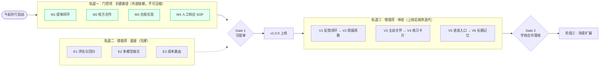
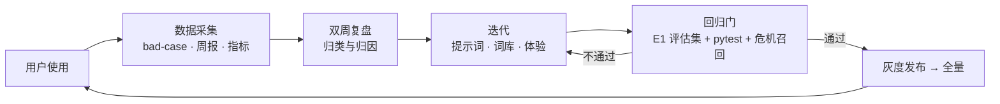

# 心屿 · 二期改进方案

| 项 | 内容 |
|---|---|
| 文档版本 | v1.1 |
| 状态 | 已生效：目标已拍板为「**真实上线**」，M3 / M4 / M6 已启动（见 §10.3 执行进展） |
| 定位 | 一期（P0–P5）交付后的二期路线规划：**以「真实上线」与「上线后用户（客户）体验持续提升」为核心，以「持续迭代、可回归验证」为开发理念** |
| 适用范围 | 后端、小程序、内容运营、校方合作 |
| 关联文档 | `docs/versioning.md`（里程碑 tag 规则）、`docs/repo-governance.md`（文档/命名规范）、`docs/crisis-lexicon-workflow.md`、`docs/beta-plan-p5.md` |

> 一句话目标：**先把产品真正送上线（门控项先行），再用一套可持续的迭代机制，把「用过的人还愿意再用」做出来。**

> 口径说明：本文档中的价值 / 成本为 1–10 分主观评估，仅用于排序讨论，非精确度量。成本估算基于「1 名全栈开发」节奏（与一期一致）。

---

## 一、现状盘点

### 1.1 一期已交付（P0–P5）

| 模块 | 完成情况 |
|---|---|
| 对话闭环 | 微信登录（JWT 双令牌 + 静默续期）、会话管理、SSE 流式对话、非流式降级、20 轮窗口记忆 |
| 危机拦截（红线） | 本地两级词库同步拦截（一级强信号 79 条，召回 ≥95%，一票否决通过）、求助卡片一键拨打、风险事件审计留档 |
| 情绪识别 | 六类情绪 + 强度 1–10 + evidence，GLM 轻量档分析，严格一致率 86.4%、强度 MAE 1.37 |
| 情绪数据 | 每日打卡（五档 mood + streak）、情绪日志（对话 + 打卡双来源合并）、趋势聚合（day/week/month） |
| 反馈闭环（半） | 回复点赞/点踩，点踩原因归档 bad-case（**只收集，未迭代**） |
| 隐私合规 | 对话 AES-256-GCM 加密入库、隐私单独同意、数据导出、软删 30 天可撤销、日志脱敏 |
| 工程质量 | pytest 81 项全绿、ruff 无 error、`/health` 压测 3816 req/s、评估集 59 条 |
| 文档 | 开发文档、API 文档、隐私政策、提审材料包、内测方案均已留档 |

### 1.2 上线前的真实缺口（事实清单，已逐条核对仓库）

一期功能层面可用，但**距离「一个真正能上线、且上线后不出问题」的产品还有硬缺口**。以下为核对仓库后的结论，标注 🔴 的为二期新增发现（原始草案未覆盖）。

| # | 缺口 | 核对结论 | 影响 |
|---|---|---|---|
| G1 | 域名与 HTTPS 证书未定 | README API 文档 Base URL 仍为 `api.xinyu.example.cn [待定]` | 上不了线 |
| G2 | 微信提审未真正走 | 主体 / 类目未拍板，医疗健康类目存在资质风险 | 上不了线 |
| G3 | 校心理中心电话与转介未落实 | 求助资源第 4 条仍为 `0XX-XXXXXXXX [待填]` | 专业度 / 责任边界 |
| G4 | 限流为内存固定窗口单机实现 | [ratelimit.py](file:///Users/caspian/campus-psychological-agent/backend/app/core/ratelimit.py) 明确注释「多进程/多实例需替换为 Redis」 | 上线后限流失效 |
| G5 | 数据保存期限与校方约定未谈 | 未谈 | 合规承诺 |
| G6 | 最终产品名未定 | 「心屿」为工作代号 | 提审材料 / 域名 |
| 🔴 G7 | **「软删 30 天后物理删除」承诺当前不会兑现** | [privacy.py](file:///Users/caspian/campus-psychological-agent/backend/app/services/privacy.py#L196-L220) 的 `purge_expired_data()` 已实现，但**全仓无任何调用点**：无调度器、未挂 lifespan、无 cron | 合规承诺与实现不符，属 PIPL 风险（✅ M3 已接入调度） |
| 🔴 G8 | **会话并发上限口径不一致** | [config.py](file:///Users/caspian/campus-psychological-agent/backend/app/config.py#L43) 为 `15`，而 README / API 文档对外承诺「活跃会话上限 3 个（code=2003）」 | 对外契约与实现不符，提审与客服口径混乱（✅ M6 已对齐为 3） |
| 🔴 G9 | **微信内容安全接口未接入** | 全仓无 `msgSecCheck` 相关调用（仅文档提及） | 提审常见驳回项 |
| 🔴 G10 | **README「数据导出（二期实现）」描述已过期** | [users.py](file:///Users/caspian/campus-psychological-agent/backend/app/api/routes/users.py#L37-L40) 与 [privacy.py](file:///Users/caspian/campus-psychological-agent/backend/app/services/privacy.py#L50) 已实现导出 | 文档与实现不符，易误导评审（✅ M6 已修正） |
| 🔴 G11 | **危机告警无人工响应闭环** | 风险事件仅落库审计，无值班 / 升级路径定义 | 上线后高危事件无人响应＝责任风险（⏳ M4 草案已出，待落地） |

> G7 / G8 / G10 属「文档与实现不一致」，修复成本极低（G10 改文字即可）；G7 / G11 是**真实风险**，不是文档问题。

---

## 二、二期核心理念与设计原则

### 2.1 两条核心，一个理念

- **核心一 · 真正上线**：先把「能否上线」的条件清空（门控项），功能迭代不能替代上线前必须完成的事。
- **核心二 · 客户后期体验**：上线不是终点。用户留存与自我觉察的闭环，取决于上线后能否持续变好。
- **理念 · 不断完善、持续更新**：用一套可复制的机制（采集 → 复盘 → 迭代 → 回归 → 发布）代替「一次性做完」。

### 2.2 三条轨道（替代原先「价值/成本」单一分类）

原分类把 A 类打了「价值 9 分」，但 A 类不是「价值高」，而是**必要条件**。把它们与体验项放进同一张矩阵，会让排序失真。建议按**依赖来源**分成三条轨道：

| 轨道 | 定义 | 排序依据 | 关键特征 |
|---|---|---|---|
| **轨道一 · 门控项（M）** | 不做就上不了线 / 过不了审 / 承诺兑现不了 | 不由工时决定，而由**外部方节奏**决定 | **在关键路径上，且不可压缩** |
| **轨道二 · 使能项（E）** | 不直接面向用户，但后续每次迭代都依赖它 | 依赖广度（被多少项依赖） | 应**先于**体验项建好 |
| **轨道三 · 增值项（V）** | 直接提升用户体验，纯开发可交付 | 价值 / 成本 | 上线后按序迭代 |

### 2.3 五条设计原则

1. **上线上线**：门控项与开发**并行推进**，不排队；门控项不完成，体验项做得再好也无法交付。
2. **体验为核**：增值项一律以「用户用完这一版，是否更愿意用下一版」为验收，而非「功能是否做完」。
3. **可回归**：任何改动 LLM 行为的项（记忆、语音、容灾）**必须**先过评估集回归门。
4. **隐私基线不破**：新增个人数据能力（长期记忆、看板、量表）一律延续一期基线——加密存储、最小化收集、行权可用。
5. **口径单一**：对外承诺（会话上限、留存期限、导出时效）以代码为准，文档与实现不允许各说一套（见 G8 / G10）。

---

## 三、关键路径：把门控项提到最前面  ★

### 3.1 为什么门控项必须在关键路径上

关键路径 = 决定项目**最短交付时间**的那条链条。传统排序按「开发工时」估成本，会得出一个错误结论：门控项工时少（如 M2 校方合作成本仅 3），所以「可以晚点做」。

但门控项的真实约束**不是工时，而是外部方的配合节奏**：

- 微信类目资质审核、内容安全接口接入 → 节奏由**微信官方**决定；
- 校心理中心电话、转介协议、数据留存期限 → 节奏由**校方**决定；
- 合规承诺（物理删除、留存期限）→ 需要**运营 + 校方**共同确认口径。

这些环节**不受我们控制、且无法用加人加班压缩**。因此，门控项是整条链条上**最长、也最不可压缩**的一段。结论：

> **门控项不是「先做的一批任务」，而是「今天就要并行启动的外部依赖」。体验项可以在门控项等待外部方的同时开发，但门控项本身绝不允许排队。**

### 3.2 关键路径图（简化视图）

说明：轨道一内部四项目前可并行启动，但均以 **Gate 1（可提审）** 为共同出口；轨道二用虚线汇入，表示它是 Gate 1 的**使能条件**而非串联步骤。

### 3.3 门控项清单

| 编号 | 项目 | 核心动作 | 前置条件 | 验收标准 | 成本 |
|---|---|---|---|---|---|
| **M1** | 提审闭环 | ① 定主体（个人/学校）与类目（以微信官方最新规则核实，医疗健康类目需资质）；② 接入微信内容安全接口；③ 隐私政策页面 + 同意弹窗上线；④ 补客服/投诉渠道 | 无（可立即启动） | 小程序**提交并通过**提审，可发布 | 5 |
| **M2** | 校方合作 | ① 回填校心理中心电话（G3）；② 谈转介合作（卡片文案、线下预约口径）；③ 与校方约定对话数据保存期限与用途（G5） | 需打通校方联系人 | 求助资源无占位；转介协议书面确认；留存期限书面确认 | 3 |
| **M3** | 合规承诺兑现 🔴 | ① 为 `purge_expired_data()` 接入调度（lifespan 定时 / 外部 cron / APScheduler 三选一），并补「到期物理删除」的自动化测试（G7）；② 落定留存期限口径；③ 语音合规预案：明确「转写即弃、不落原始音频」 | M2（留存期限） | 到期数据可被自动物理删除（测试可证）；留存期限对外一致 | 2 |
| **M4** | 人工响应 SOP 🔴 | 定义高危风险事件的**人工响应链**：值班人、响应时限、升级路径、留痕方式；与校心理中心对接 | M2 | 高危告警有明确 owner 与 SLA，且演练一次 | 3 |
| **M5** | 生产化基建 | ① 内存限流 → Redis（[ratelimit.py](file:///Users/caspian/campus-psychological-agent/backend/app/core/ratelimit.py)）；② 域名 + HTTPS 证书（G1）；③ 监控告警：优先覆盖「大模型超时」「危机拦截漏报」两处最敏感点；④ 模型成本周报；⑤ dev/prod 密钥分离（`wx_mock_login` 生产必须 `false`） | 无（可立即启动） | 生产环境限流跨实例生效；有告警与周报；无占位域名 | 5 |
| **M6** | 口径与文档对齐 🔴 | ① 统一会话并发上限口径（G8：定 3 还是 15，改代码或改文档）；② 修正 README 数据导出描述（G10）；③ 复核 Base URL 占位 | 无 | 文档与实现逐条一致，无已知矛盾 | 1 |

> M6 成本极低但价值被低估：**对外口径不一致会在提审应答与客服场景中被放大**，属于性价比最高的一项。

### 3.4 门控项与开发并行节奏

| 阶段 | 门控项（并行，外部驱动） | 开发（我方驱动） | 出口 |
|---|---|---|---|
| 第 1 波 | M1 启动（主体/类目核实）、M2 启动（联系校方）、M5 启动、M6 完成 | E1 评估与回归（先建） | — |
| 第 2 波 | M1 接入内容安全、M3 完成、M4 完成 | V1 反馈闭环、V2 周报洞察 | **Gate 1：可提审** |
| 第 3 波 | — | V5 语音、V6 长期记忆、V3 主动关怀、V4 练习卡片 | v1.0.0 上线后按序 |

---

## 四、改进方向总览

| 编号 | 轨道 | 方向 | 价值 | 成本 | 优先级 | 一句话说明 |
|---|---|---|---|---|---|---|
| M1 | 门控 | 提审闭环（原 A2） | 9 | 5 | **关键路径** | 主体/类目 + 内容安全 + 隐私页 + 客服 |
| M2 | 门控 | 校方合作（原 A3） | 9 | 3 | **关键路径** | 电话 + 转介 + 留存期限，成本最低、专业度最高 |
| M3 | 门控 | 合规兑现 🔴 | 8 | 2 | **关键路径** | 物理删除调度 + 留存期限 + 音频合规预案 |
| M4 | 门控 | 人工响应 SOP 🔴 | 8 | 3 | **关键路径** | 高危事件的值班与升级路径 |
| M5 | 门控 | 生产化基建（原 A1） | 9 | 5 | **关键路径** | Redis 限流 + 域名 HTTPS + 监控告警 + 成本周报 |
| M6 | 门控 | 口径与文档对齐 🔴 | 6 | 1 | **速赢** | 会话上限 3 vs 15、导出描述过期 |
| E1 | 使能 | 评估与回归流水线（新增 D0） | 8 | 4 | **先建** | 每次改动 LLM 行为的兜底门 |
| E2 | 使能 | 多模型容灾（原 D1） | 7 | 5 | 中期 | 通义千问备用，避免单供应商单点 |
| E3 | 使能 | 成本路由与窗口摘要（原 D2） | 6 | 4 | 中期 | 轻/主档分级 + 长会话摘要压缩 |
| V1 | 增值 | 反馈闭环引擎（原 B6） | 7 | 2 | **速赢** | bad-case 复盘 → 提示词/词库迭代 |
| V2 | 增值 | 周报洞察（原 B5） | 7 | 2 | **速赢** | 趋势数据现成，生成「本周情绪小结」 |
| V3 | 增值 | 主动关怀（原 B2） | 8 | 4 | 可选速赢 | 连续低落 → 订阅消息次日问候 |
| V4 | 增值 | 练习卡片（原 B4） | 7 | 3 | 可选速赢 | 呼吸/正念/行为激活做成可交互组件 |
| V5 | 增值 | 语音入口（原 B3） | 8 | 6 | 重点 | 录音 → 转写 → 可选语音回复 |
| V6 | 增值 | 长期记忆（原 B1） | 8 | 7 | 重点 | 跨会话记住人物/事件/偏好 |
| V7 | 增值 | 场景扩展（原 C1/C2/C3） | 7 | 6–7 | 谨慎 | 量表自评 / 教师端看板 / 内容库 |
| — | — | 群组互助（原 C4） | 5 | 9 | **不做** | 合规与审核成本过高 |

> 相对原始草案，本表调整了三项成本评分：**V5 语音** 5 → 6、**V6 长期记忆** 6 → 7（理由见 5.3），并新增 M3 / M4 / M6 三项门控。

---

## 五、方向详情

### 5.1 轨道一 · 门控项（上线必需）

#### M1 · 提审闭环（原 A2）
- **做什么**：确定小程序申报主体（个人 / 学校）与类目（医疗健康类目通常需资质，需以微信官方最新规则核实）；接入微信内容安全接口（`msgSecCheck`，提审常用要求，当前未实现 G9）；隐私政策页面 + 同意弹窗上线；补充客服/投诉渠道。
- **为什么**：文档已标注「规避方向需与运营确认」，此项直接决定能否过审。
- **注意**：命名与简介避开「心理咨询/治疗/诊断」字样，定位为「情绪记录与陪伴工具」；但**注意内在张力**——产品同时具备危机干预与转介能力，提审应答时需如实说明边界（只做转介、不处理危机），口径必须与 M4 一致。

#### M2 · 校方合作（原 A3）
- **做什么**：确认校心理中心电话并回填求助资源第 4 条；与心理中心谈转介合作方式（卡片文案、线下预约口径）；与校方约定对话数据保存期限与用途。
- **为什么**：求助卡片第 4 条目前是占位；转介合作直接体现产品专业度与责任边界。
- **注意**：这是**外部依赖最重、最容易低估**的一项，必须今起并行启动（见 3.1）。

#### M3 · 合规承诺兑现 🔴（新增）
- **做什么**：
  1. 为 [privacy.py](file:///Users/caspian/campus-psychological-agent/backend/app/services/privacy.py#L196-L220) 的 `purge_expired_data()` 接入调度（三选一：FastAPI lifespan 定时任务 / 外部 cron / APScheduler），并补一条**到期数据被物理删除**的自动化测试；
  2. 落定并对外统一数据留存期限（依赖 M2）；
  3. 语音合规预案：若后续做 V5，明确「转写后即弃、不落原始音频」。
- **为什么**：G7——「软删 30 天后物理删除」是对外承诺，当前实现无调用点，**承诺不会兑现**。这是真实合规风险，且修复成本极低。
- **注意**：不要用「注明待办」代替修复；此项必须可被测试证明。

#### M4 · 人工响应 SOP 🔴（新增）
- **做什么**：定义高危风险事件（一级词库命中 / 模型高风险）的人工响应链——值班人、响应时限（SLA）、升级路径、留痕方式；与校心理中心对接落地。
- **为什么**：G11——一票否决机制抓到高危事件后，若无人响应，等于把责任风险留空。这不是技术项而是运营项，但它是**上线的前置条件**。
- **注意**：SOP 须与 M1 的提审口径、M2 的转介协议对齐，三者讲同一套故事。

#### M5 · 生产化基建（原 A1）
- **做什么**：内存限流替换为 Redis 限流（登录/消息/读接口，解决 G4）；申请域名并配置 HTTPS 证书（G1）；日志监控与告警（错误率、接口耗时、模型调用失败）；模型成本周报；dev/prod 密钥分离（配置层已具备 `env` 字段，需落实 `wx_mock_login=false`）。
- **为什么**：README 与 API 文档已明确标注「生产需替换」，是上线硬门槛；固定窗口限流还存在窗口边界突刺问题，多实例部署会直接失效。
- **注意**：密钥一律走环境变量，禁止入库；监控告警先覆盖「大模型超时」「危机拦截漏报」两个最敏感点。

#### M6 · 口径与文档对齐 🔴（新增）
- **做什么**：① 统一会话并发上限口径——[config.py](file:///Users/caspian/campus-psychological-agent/backend/app/config.py#L43) 为 `15`，README/API 文档为 `3`，选定其一并同步（G8）；② 修正 README 中「数据导出（二期实现）」的过期描述（G10）；③ 复核 Base URL 占位。
- **为什么**：对外承诺与实现不一致，会在提审应答与客服场景中被放大。
- **注意**：本项成本仅 1 分，属于**性价比最高的一项**，建议随第一批改动一起做掉。

### 5.2 轨道二 · 使能项（持续迭代的底座）

#### E1 · 评估与回归流水线（新增，原草案仅在「注意」中一笔带过）
- **做什么**：把评估集从 59 条扩到覆盖**记忆注入、语音转写噪声、备用模型输出格式**；固化为 CI 回归门（与 pytest、危机召回测试并列）。
- **为什么**：V5 / V6 / E2 每一项都在改 LLM 行为，唯一的客观兜底就是评估集。它是「持续迭代」理念的**技术前提**——没有回归门，迭代就是盲改。
- **注意**：评估集扩充应与 E1 同步建立「新增能力 → 新增评估样本」的惯例，而不是事后补。

#### E2 · 多模型容灾（原 D1）
- **做什么**：接入通义千问等备用供应商（架构图已预留），主模型故障时自动切换 / 降级。
- **注意**：切换后提示词与解析需做兼容性回归（复用 E1）；建议**先建 E1 再做 E2**。

#### E3 · 模型路由与成本优化（原 D2）
- **做什么**：简单共情/闲聊走轻量档、复杂疏导走主档；长会话用摘要压缩替代全量窗口；维持成本周报基线。
- **注意**：现值约 0.02 元/天/用户，量级很小、收益有限，且摘要压缩有质量风险，**同意放在中期**，优先级可低于 E1/E2。

### 5.3 轨道三 · 增值项（客户体验）

#### V1 · 反馈闭环引擎（原 B6）
- **做什么**：把已收集的点赞/点踩 bad-case 做成定期复盘机制（每周导出 → 人工归类 → 提示词/危机词库迭代 → 回归评估集），形成「收集 → 复盘 → 迭代 → 验证」的循环。
- **价值**：当前只收集不迭代，反馈数据在浪费；此机制是整个体验迭代的发动机。
- **验收**：每两周至少一个可归因的迭代项，且过 E1 回归门。

#### V2 · 周报洞察（原 B5）
- **做什么**：基于现有趋势聚合生成「本周情绪小结」，展示在情绪日志页或作为订阅消息发送。
- **注意**：模式发现只做描述性结论，不做归因断言（「本周焦虑多出现在……」而非「考试导致焦虑」）。

#### V3 · 主动关怀（原 B2）
- **做什么**：基于情绪日志（连续 N 天 low/negative 或打卡中断），通过微信订阅消息在次日温和问候 / 引导打卡；用户可随时关闭。
- **注意**：必须用户订阅授权 + 频控（一周最多 1–2 条）；文案避免说教感（可复用 `preachy` 反馈类目作为负面样本）。

#### V4 · 练习卡片（原 B4）
- **做什么**：把提示词里已有的「身体优先 / 呼吸练习」话术产品化——呼吸引导动画、正念音频、行为激活小任务，做成对话中可交互的组件卡片。
- **注意**：内容需专业审校（联动 M2 心理中心老师）；进度与完成反馈落库，可计入情绪日志。

#### V5 · 语音入口（原 B3）— 成本上调 5 → 6
- **做什么**：小程序录音 → 语音转文字后进入对话；可选 AI 语音回复（TTS）。
- **为什么上调成本**：不只是「微信录音权限」——还包含 **ASR 服务成本 + 额外延迟**，以及**音频合规**（语音可能构成敏感个人信息，需明确不落原始音频，见 M3）。
- **注意**：转写结果需先展示给用户确认再发送，避免误转写；语音是倾诉场景最自然的升级，价值高，建议放在上线后重点推进。

#### V6 · 长期记忆（原 B1）— 成本上调 6 → 7
- **做什么**：在 20 轮窗口之外增加跨会话长期记忆——抽取并保存关键人物、事件、偏好、情绪诱因，后续回复自动带入。
- **为什么上调成本**：除抽取/存储外，还包含**抽取稳定性评估**（需进 E1）、**记忆注入的 token 成本**、**查看/删除记忆的交互**、**加密存储**，以及与 20 轮窗口的关系处理。
- **注意**：记忆内容同样加密；允许用户查看/删除（延续 PIPL 行权思路，与 M3 的删除机制共用）；记忆注入要有克制，不喧宾夺主。

#### V7 · 场景扩展（原 C1 / C2 / C3）— 谨慎
- **C2 教师端看板**：面向辅导员/心理中心的匿名聚合班级情绪趋势。**硬闸门：隐私口径（只给聚合不给个体）必须先定死并写入用户协议，否则不立项**——它是唯一一个「做错一次、用户信任不可逆」的功能。
- **C1 量表自评**：PHQ-9 / GAD-7 存在版权与使用规范问题，「打分 + 建议」易被理解为诊断；若做，需先与心理中心确认授权与解释口径（联动 M2）。
- **C3 内容库**：可作为 V4 练习卡片的扩展内容，暂不单独立项。

#### 不做：群组互助（原 C4）
- 合规风险高（内容审核、隐私、人身安全责任）、审核与管理成本大，一 / 二期均不立项。

---

## 六、持续迭代机制（「不断完善开发更新」为理念）

门控项让我们**能上线**；这一章让产品**上线之后还能持续变好**。

### 6.1 迭代闭环

### 6.2 四条运营机制

| 机制 | 频率 | 负责 | 产物 |
|---|---|---|---|
| bad-case 复盘 | 双周 | 产品 + 后端 | 迭代项清单（提示词/词库） |
| 模型成本周报 | 每周 | 后端 | 成本基线 + 异常告警 |
| 危机召回回归 | 每次词库/提示词改动 | 后端 | 召回率不降的证明 |
| 高危事件复盘 | 每次高危触发后 48h | M4 值班人 | 响应是否及时、话术是否得当 |

### 6.3 版本与发布节奏

- **节奏**：上线后每 2 周一个 MINOR 版本（`v1.1.0`、`v1.2.0`…），符合 `docs/versioning.md` 的 SemVer 规则。
- **质量门**（沿用仓库规则）：`ruff check .` + `pytest -q` 全绿 + E1 评估集 + 危机召回不降。
- **灰度与回滚**：新功能先小流量（或仅内测用户），指标不劣化再全量；保留一键回滚（降级开关已具备 `stream_enabled` / `emotion_analysis_enabled`，可延续为发布开关）。
- **文档同步**：任何对外承诺的变更（上限、期限、时效）当次提交一并更新文档，防止再出现 G8 / G10。

---

## 七、优先级矩阵与场景化组合

### 7.1 矩阵

| | 成本低（≤5） | 成本高（>5） |
|---|---|---|
| **价值高（≥8）** | **关键路径**：M2 校方合作、M3 合规兑现、M4 人工响应 SOP、M1 提审闭环、M5 生产化基建、V3 主动关怀、E1 评估与回归 | **重点投入**：V5 语音入口、V6 长期记忆 |
| **价值中（5–7）** | **速赢**：M6 口径对齐、V1 反馈闭环、V2 周报洞察、V4 练习卡片 | **谨慎/中期**：E2 多模型容灾、E3 成本路由、V7 场景扩展 |

> 轨道一（M）整体位于左侧上方「关键路径」，这不是因为分值，而是因为**它们不由分值决定交付时间**（见第三章）。

### 7.2 场景化组合

**场景一 · 目标是真实上线（本文档默认建议）**
- 轨道一六项全做（M1–M6），其中 M6 随第一批改动顺手做掉。
- 速赢顺手做：V1 反馈闭环、V2 周报洞察（数据现成、成本最低）。
- 第二波体验：V5 语音、V6 长期记忆（上线后按反馈迭代推进）。
- E1 必须**先于** V5 / V6 / E2 建好。

**场景二 · 目标是结题 / 比赛演示**
- 在场景一基础上，演示期前集中做「能直接感觉到」的项：V5 语音 + V6 长期记忆 + V4 练习卡片。
- 门控项至少完成 M5 生产化基建（一句话能讲清的工程动作）+ M2 校方合作（体现专业度与责任边界）。

**场景三 · 目标是长期运营**
- 在场景一基础上，把 V7 中的 C2 教师端看板提上议程（学校侧价值最大），但**必须先定隐私口径**。
- C1 量表自评、C3 内容库按学校合作进展决定；C4 群组互助不做。

> 推荐主张：**场景一与场景二是同一路线的前后段**——以「真实上线」为默认目标推进，它的产物是场景二的超集，只需在演示前加一段「体验冲刺」。

---

## 八、分期路线与里程碑

| 阶段 | 内容 | 验收线 | 里程碑 tag | 版本 |
|---|---|---|---|---|
| **阶段一 · 上线必需** | 门控项 M1–M6 + 使能项 E1 + 速赢 V1 / V2 | **能提交提审并通过**，且合规承诺可被测试证明 | `m6` | `v1.0.0`（与提审绑定，见 versioning） |
| **阶段二 · 体验深项** | V5 语音 + V6 长期记忆 + V3 主动关怀 + V4 练习卡片 + E2 / E3 | 内测用户**留存 / 反馈**提升 | `m7` | `v1.1.0` |
| **阶段三 · 场景扩展** | V7（按隐私口径与学校合作决定） | **学校合作落地**为启动条件 | `m8` | `v1.2.0` |

> 里程碑 tag 沿用仓库规则（`docs/repo-governance.md`：`m<编号>`）；一期 P0–P5 占用 `m0`–`m5`，故二期自 `m6` 起。

---

## 九、待拍板问题清单

| # | 问题 | 影响 | 当前状态 | 建议 |
|---|---|---|---|---|
| 1 | 后期目标：真实上线 / 结题展示 / 长期运营？ | 决定排序 | 未定 | 默认按「真实上线」推进，它同时产出结题展示所需材料 |
| 2 | 申报主体：个人 / 学校？类目如何选？ | 能否过审（M1） | 待核实 | 尽早核实微信官方最新规则 |
| 3 | 校心理中心电话与转介方式 | M2 前置 | 占位待填 | 今起并行启动 |
| 4 | 对话数据保存期限与校方约定 | 合规与产品承诺（M3） | 未谈 | 与 M2 一并谈 |
| 5 | 最终产品名 | 品牌与提审材料 | 未定 | 越早越好，卡提审与域名 |
| 6 | 会话并发上限：3 还是 15？ | 对外口径（M6） | ✅ **已定：3**（README/API 文档/.env.example 三处均为 3，config 默认值已由 15 对齐为 3） | 已同步代码与文档 |
| 7 | 教师端看板隐私口径（聚合 vs 个体） | 决定 C2 是否立项 | 未定 | 须先定死并写入用户协议 |
| 8 | 长期记忆若做，用户查看/删除的交互 | 隐私行权一致性 | 设计待定 | 与 M3 删除机制共用 |
| 9 | 高危事件值班与响应 SLA 🔴 | 上线前置（M4） | 无 | 需明确 owner 与时限 |

---

## 十、附录：口径、假设与变更记录

### 10.1 口径与假设
- 价值 / 成本评分为 1–10 主观评估，最终以成员讨论结果更新。
- 成本估算基于「1 名全栈开发」节奏（与一期一致）。
- 提审类目、内容安全接口要求等外部规则，以微信官方最新规则为准（文档已标注「需核实」）。
- 所有新增个人数据能力（长期记忆、教师看板、量表）均延续一期隐私基线：加密存储、最小化收集、行权可用。

### 10.2 相对原始草案（v0.1）的变更
1. 分类由「价值 / 成本」两轴改为**三条轨道**（门控 / 使能 / 增值），并把门控项明确置于**关键路径**（第三章）。
2. 新增三项门控：**M3 合规兑现**（物理删除调度）、**M4 人工响应 SOP**、**M6 口径与文档对齐**。
3. 新增使能项 **E1 评估与回归流水线**（原草案仅在「注意」中提及）。
4. 调整成本评分：**V5 语音 5→6**、**V6 长期记忆 6→7**。
5. 新增第六章「持续迭代机制」，落实「不断完善开发更新」的理念。
6. 为 C2 教师端看板增加**隐私口径硬闸门**。

### 10.3 执行进展（滚动更新）

| 编号 | 动作 | 状态 | 证据 |
|---|---|---|---|
| **M6** | 会话上限对齐为 3（代码 + 文档）、修正 README 数据导出描述、复核 Base URL 占位 | ✅ **已完成** | `config.py` `session_concurrency_limit=3`；`.env.example` 一致；README「数据导出」改为「同步 JSON（限流为二期规划）」；Base URL 占位标注准确（属 M5） |
| **M3** | 为 `purge_expired_data()` 接入 lifespan 调度 + 留存期限可配置 + 到期物理删除测试 | ✅ **代码完成**（留存期限待 M2 确认） | `privacy.run_purge_scheduler()`（`main.lifespan` 启动/取消）；新增 `test_purge_expired_data`（未到期不删 / 到期全删）；配置 `ERASE_RECOVER_DAYS` / `DATA_PURGE_ENABLED` / `DATA_PURGE_INTERVAL_SECONDS` |
| **M4** | 高危事件人工响应 SOP | ⏳ **草案已出，待落地** | `docs/crisis-response-sop.md`（值班/SLA/升级/留痕；校方联系人与 SLA 数值待 M2/运营补齐） |

> 剩余门控（M1 提审、M2 校方合作、M5 生产化基建）仍为待启动/外部驱动项，见第三章关键路径。

---

### 10.4 变更记录

| 版本 | 日期 | 说明 |
|---|---|---|
| v0.1 | 2026-10-15 | 讨论产出草案（未定稿） |
| v1.0 | 2026-10-15 | 本版：确立关键路径与三轨道、补充 M3/M4/M6、E1，新增迭代机制章 |
| v1.1 | 2026-10-15 | 按「真实上线」目标启动：完成 M3（代码）/ M6，M4 草案落地；见 §10.3 执行进展 |
